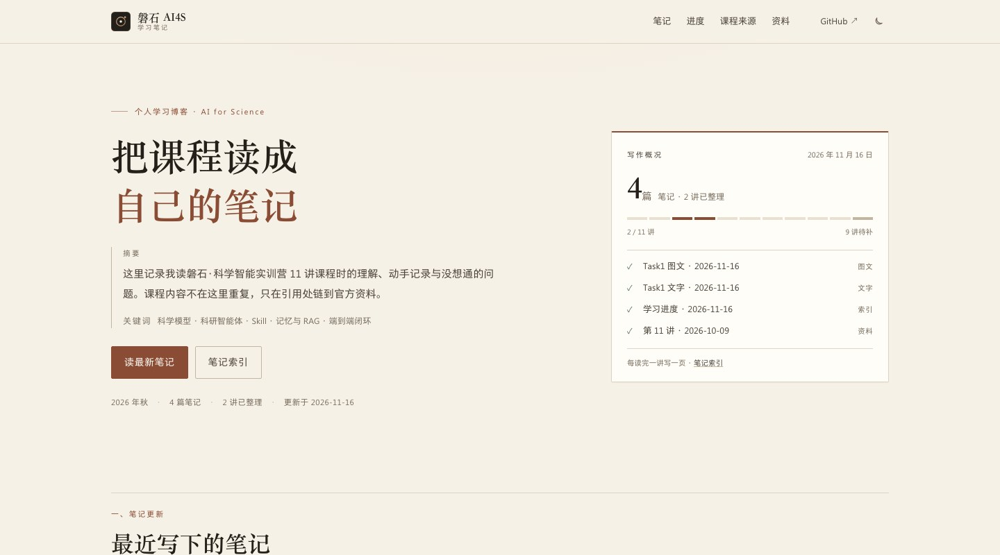

# 展示页（`docs/`）



[`index.html`](index.html) 是「磐石 AI4S · 课程索引与学习笔记」的静态展示页：单页、无构建步骤、无外部字体或 CDN 依赖，可以直接用浏览器打开，也可以部署到 GitHub Pages。

## 本地预览

```bash
cd docs
python3 -m http.server 8765
# 打开 http://127.0.0.1:8765/
```

## 线上地址

<https://biociao.github.io/panshi-ai4s-practice/>

已通过 GitHub Pages 发布：**Deploy from a branch**，`study` 分支 / `/docs` 目录（legacy build）。

若要在别的 fork 重新部署：

1. 把 `docs/` 提交到 `study` 分支并 push。
2. 仓库 **Settings → Pages → Build and deployment**：Source 选 **Deploy from a branch**，Branch 选 `study`，Folder 选 `/docs`。
3. 稍等片刻，访问 `https://<用户名>.github.io/panshi-ai4s-practice/`。

> 页面里的 PDF、笔记链接都指向 GitHub 的 `study` 分支。部署前请确认 `learning/notes/task1/`、`learning/progress.md` 已推送，否则 Task1 相关链接会 404。
>
> 如果希望站点完全自包含（不依赖 GitHub 分支），可以把 PDF 和笔记复制进 `docs/` 并改用相对链接；当前选择绝对链接，是为了避免在仓库里重复存放 103 MB 的课件。

## 目录结构

```
docs/
├── index.html              页面结构（单页）
├── assets/
│   ├── style.css           样式（深浅主题、响应式）
│   ├── app.js              交互（主题、筛选、进度动画、滚动显现）
│   ├── favicon.svg
│   ├── covers/01–11.webp   各讲 PDF 首页渲染的封面，仅用于索引识别
│   └── notes/task1-map.webp
└── .nojekyll               跳过 Jekyll 处理
```

## 更新数据

页面里的讲次信息与进度是静态写死的。更新 `learning/progress.md` 后，需要同步修改 `index.html` 中对应的几处：

- **顶部快照**：`74 / 334 页`、`2 / 11 讲`、`segbar` 与快照列表。
- **学习路线**：四张 track 卡的讲次 / 页数 / 进度条 `data-fill`。
- **课程目录**：每张 `.lec` 卡的状态 `badge`（`done` / `todo` / `reading`）与「笔记」链接。
- **学习进度**：环形图 `data-ring`、分轨 `bar i[data-fill]`、统计数字。
- **页脚**：更新日期。

## 说明

- 封面图从公开 PDF 首页以 PyMuPDF 渲染，只用于讲次识别；课件版权归原作者与讲师。
- 页面不转载课件正文，只摘录课程标题、页码与个人理解。
- 深色 / 浅色主题、`prefers-reduced-motion`、键盘焦点与移动端菜单均已适配。
