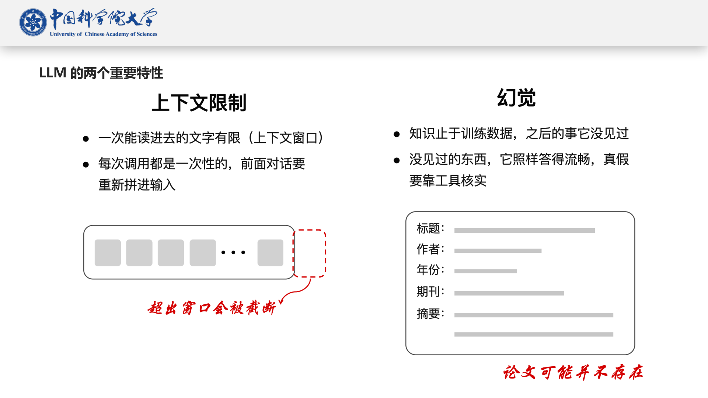
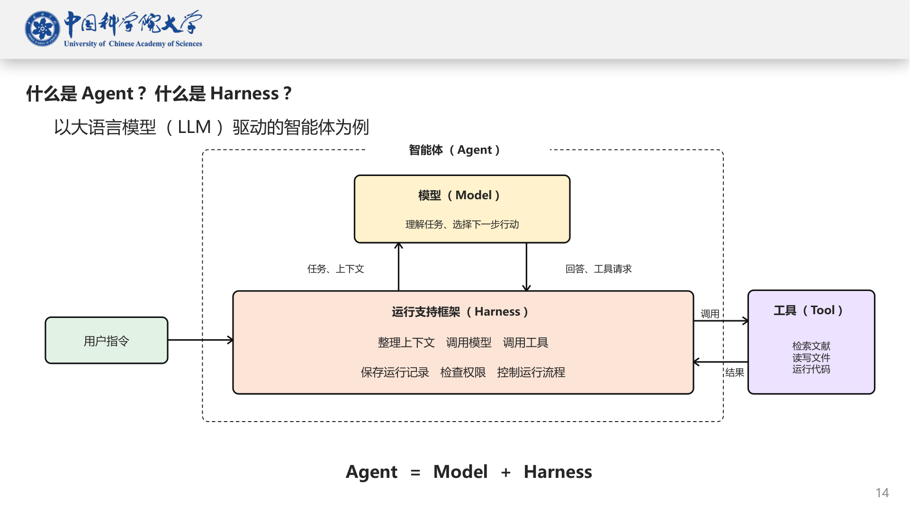
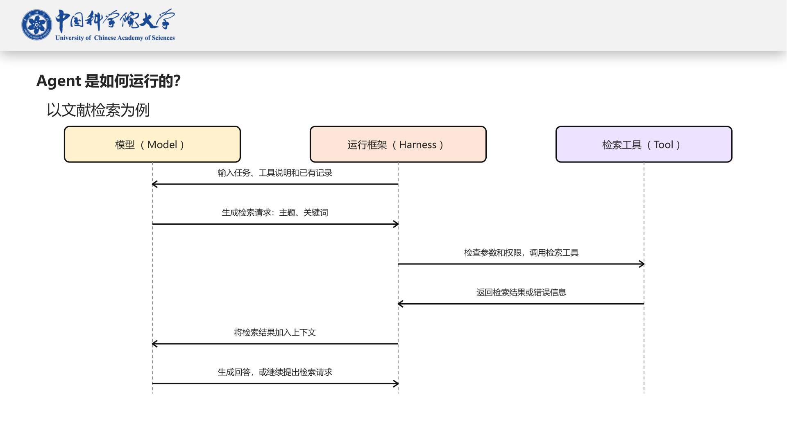
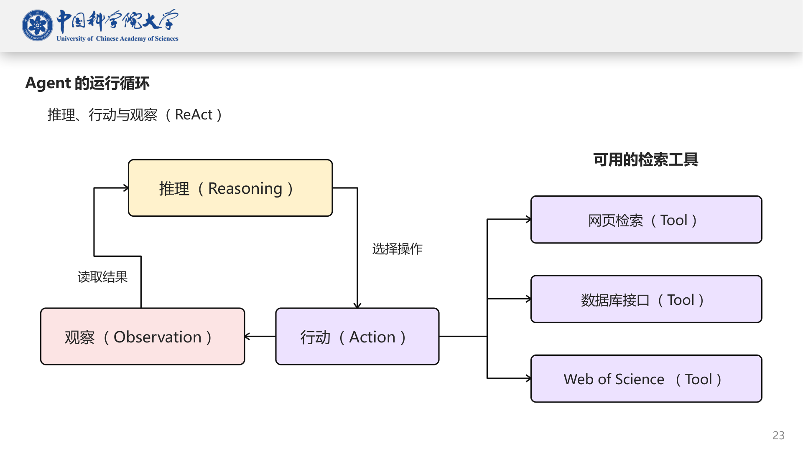
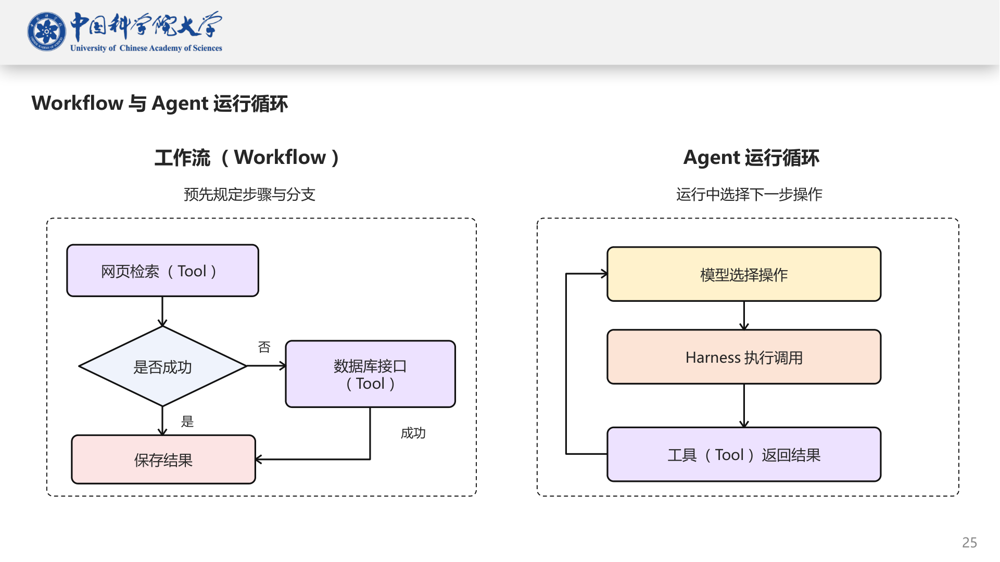
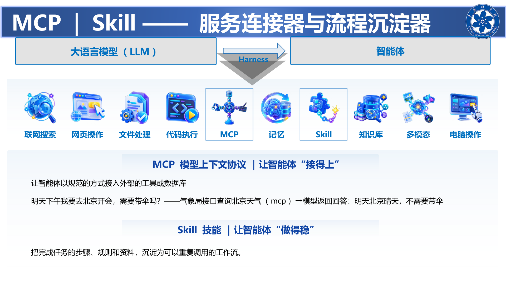
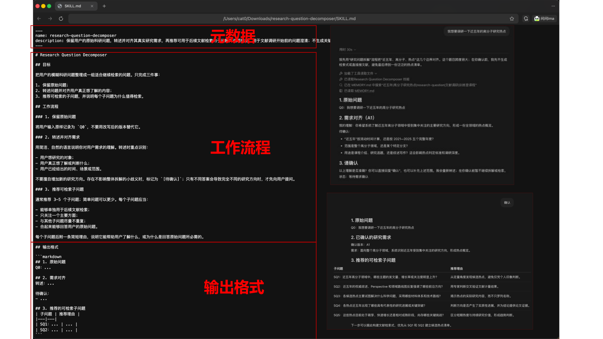
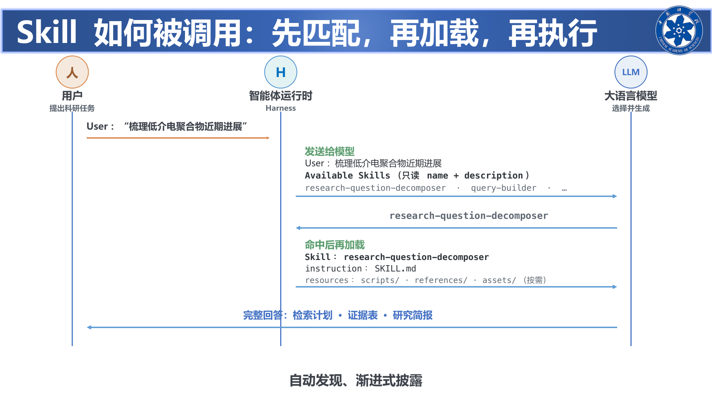
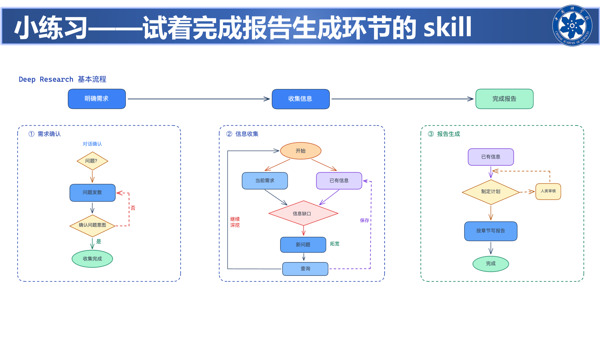

# 从模型到可复现的科研智能体

> 学习课件：[03 讲 PDF][03pdf] · [04 讲 PDF][04pdf]；原文、图片出处与版权声明见文末「资料出处与引用声明」。

大模型能写、能推理，但它本身并不能持续做事：每次调用都是一次性的，不记事，也不对事实负责。

而科研任务要求连续、可核查、可复现。把LLM放进科研语境，我们需要的不仅仅是更强的模型，还需要一套运行系统——Harness；而让这套系统越做越稳的，是把成功做法固化而成的Skill。

理解这两个概念，以及它们与工具、工作流、知识来源的关系，就理解了这本次课程的主干。

## 一、模型的边界：两个硬约束



*上下文会截断，知识会编造。这两条不是模型的“缺点”，而是它的工作方式。*

**上下文限制。** 模型每次只看到这次调用拼进去的内容。对话历史、工具说明、检索结果，都要重新拼；拼不下就截断。所以长任务不能指望模型“记住”，必须把状态外置：整理上下文、保存运行记录、把中间结果写成文件。所谓“智能体有记忆”，本质上是 Harness 在每次调用前，把该带的信息重新带进来（03-P5）。

**幻觉。** 大模型的本质是在预测下一个词，而不是在检索数据库。知识有截止时间，但没见过的东西照样答得流畅，所以真假不能靠“读起来像”，必须靠工具取回证据：检索、读文件、跑代码、查数据库。工具的意义不是让模型更聪明，而是让它能接触到自己无法凭空知道的事实（03-P5）。

这两条分别对应 Harness 的两类职责：一类管上下文，一类管工具与核验。后面的所有设计，几乎都可以从这里推出来。

## 二、Harness：把一次对话变成持续的行动

Harness（驾驭层）是“承担运行调度、能力扩展、安全约束和效果保障的工程化支持框架”（03-P3）。它做六件事：整理上下文、调用模型、调用工具、保存运行记录、检查权限、控制运行流程（03-P15）。



*用户指令进入 Harness，Harness 把任务与上下文交给模型；模型只回“回答”或“工具请求”，由 Harness 去调工具。*

这张图有一个关键约束：**模型不直接碰工具，中间永远隔着 Harness**（据 03-P15 图示）。这不是多此一举。工具调用有副作用，参数可能错，权限可能越界，失败需要重试或降级，过程需要留痕——这些都必须发生在“被约束者”之外。把权限交给模型自检，等于没有权限；把错误处理交给模型即兴发挥，等于没有错误处理。

可以借用操作系统的类比：模型是 CPU，负责计算；Harness 是操作系统，负责调度、系统调用、权限、日志和中断。CPU 很快，但没有操作系统，它什么任务也完不成。`Agent = Model + Harness` 说的就是这件事。

## 三、一次行动如何发生：时序与循环



*模型发请求，Harness 查权限并调用工具，工具返回结果或错误，结果再回到上下文。*

一次工具调用可以拆成六步（03-P16）：

```text
Harness → Model    输入：任务、工具说明、已有记录
Model   → Harness  生成检索请求：主题、关键词
Harness → Tool     检查参数和权限，调用检索工具
Tool    → Harness  返回检索结果，或错误信息
Harness → Model    将检索结果加入上下文
Model   → …        生成回答，或继续提出检索请求
```

三个细节决定了系统好不好用：

- **工具说明每次都重新输入。** 模型不记忆工具列表，工具描述写得好不好，直接决定它会不会调、调得对不对。
- **权限检查发生在 Harness。** 不在模型，也不在工具内部。
- **错误信息也是正常返回值。** 它进入上下文，模型才有机会换路；工具静默失败，模型就可能编一个结果出来。

这六步循环起来，就是 ReAct（03-P24）：



*推理 → 行动 → 观察 → 再推理。关键不是三个框，而是“观察”回到“推理”的那条回边。*

Agent 的“思考”不是一条连续的意识流，而是每一轮根据当前上下文重新构造的判断。下一步做什么，取决于上一轮工具返回了什么。这也是 Agent 与固定流水线的不同之处。

Harness 在外层给这个循环加三道保险（03-P23）：**有边界**（权限、次数、时间上限，防止死循环和失控成本）、**可中断**（需要人工处理时暂停，并说明原因）、**可恢复**（达到限制时停止并报告进度，而不是静默失败）。

## 四、Workflow 与 Agent：一个管保证，一个管应变



*左边预先规定步骤与分支，右边在运行时选择下一步。*

两者的差别可以压成一张表（03-P26）：

| | Workflow | Agent 运行循环 |
| --- | --- | --- |
| 决策方式 | 预先规定步骤与分支 | 运行中选择下一步 |
| 优点 | 可控、可测、可复现 | 灵活，能处理没预料到的情况 |
| 代价 | 预料之外的失败没法绕 | 不可预测，可能绕远或发散 |

两者不是二选一，而是嵌套关系：**外层用 Workflow 固定“必须经过哪几步”，内层每一步用 Agent 循环处理“这一步具体怎么做到”。** 比如文献综述，外层固定“检索 → 筛选 → 阅读 → 写作 → 核验”，内层让 Agent 自己决定用什么关键词、先读哪篇、要不要换数据库。

可靠性则来自失败设计：关键能力至少留两条路径（搜索工具 ↔ API / 数据库接口）；失败要显式暴露给模型，让它有机会换「备用路线」；Harness 要能降级——先试 A，A 不可用改 B，都不行才报人工。好的 Agent 不是“从不失败”，而是“失败也不怕”（03-P20~P22）。

<div class="page-break"></div>

## 五、六个概念的分工

| 概念 | 回答的问题 | 在系统里的位置 |
| --- | --- | --- |
| 模型 Model | 谁在想？ | 理解信息、推理、生成内容 |
| 工具 Tool | 能做什么？ | 检索、读写文件、运行代码等有副作用的操作 |
| 技能 Skill | 该怎么做？ | 完成一类任务的方法、脚本、规则与资源 |
| 工作流 Workflow | 按什么顺序？ | 规定步骤与分支，保证必经环节 |
| Harness | 谁来管？ | 整理上下文、调用模型与工具、检查权限、保存记录 |
| 智能体 Agent | 在哪运行？ | 感知环境并作用于环境的实体 |

*表：六个概念的分工（据 03-P19 整理）。*

最容易混的三组：

- **Skill ≠ Tool。** Tool 是“能做什么”，Skill 是“该怎么做”。
- **Skill ≠ Workflow。** Workflow 管顺序，Skill 管每一步的做法。
- **Harness ≠ Agent。** Harness 是设备与制度，Agent 是那个实体。

## 六、Skill：把一次成功变成可复用方法

一次成功的 Agent 运行，留下的是一条轨迹：用过哪些关键词、筛掉了什么、怎么核验引用。如果轨迹只存在于这次上下文里，下次开新会话就没了。Skill 要做的，就是把这类“做法”从一次性的轨迹里抽出来，写成下次可以直接加载复用的经验。



*MCP 让智能体接得上外部服务，Skill 让智能体做得稳。两者都挂在 Harness 下面，是并列的能力来源。*

**MCP 解决“接得上”。** 课件把它定义为“让智能体以规范的方式接入外部的工具或数据库”（04-P12）。它用规范化的接口，把外部工具、数据库、学术服务接进来。没有 MCP，模型只能靠训练记忆和网页搜索；有了 MCP，它可以查 OpenAlex、Crossref、内部数据库。

**Skill 解决“做得稳”。** 课件把它定义为“把完成任务的步骤、规则和资料，沉淀为可以重复调用的工作流”（04-P12）。它让下一次不必重新摸索。MCP 扩展的是触达范围，Skill 提供的是可复现性。两者不能互相替代：接得上的东西，不一定知道该怎么用；知道该怎么用，也不一定接得上。

需要注意的是，Skill 也不是单纯的文档，而是给模型的一套 SOP （有时也会加上可执行附件）。举个例子，skill应该确保换一个模型，照着skill也能做出同样质量的结果。如果做不到，那它就还只是一篇说明文档。

## 七、Skill 的结构与写法



*左边是真实的 SKILL.md，右边是它跑出来的结果。红字标出三段：元数据、工作流程、输出格式。*

一个 Skill 就是一个目录，核心只有一个文件：

```text
skills/<skill-name>/
├── SKILL.md          # 元数据 + 工作流程；唯一且必需的入口
├── scripts/          # 辅助脚本
├── references/       # 参考资料
└── assets/           # 模板、图片等素材
```

课件原文：“最小可用 Skill 只需要一个 SKILL.md；其余目录随任务需求增加。”（04-P13）

**元数据**是调用时的唯一入口。模型先看到的只有 `name` 和 `description`，所以 description 要同时写清三件事：做什么、什么时候用、不做什么。比如（据 04-P14 截图整理）：

```yaml
---
name: research-question-decomposer
description: 保留用户的原始科研问题，转述并对齐其真实研究需求，再推荐可用于后续文献检索的子问题；用于文献调研开始前的问题澄清；不生成文献综述。
---
```

**工作流程**是做法本身。以问题拆解为例：先把用户原话记为 `Q0`，再转述并对齐需求，重点识别“研究对象 / 想了解或判断什么 / 已给出的时间、场景或范围”，最后推荐 3~5 个可检索子问题，每个只关注一个方面，彼此尽量不重复，合起来能回答原始问题（04-P14）。

这里有三个可复用的设计手法：

- **编号锚点**（`Q0`、`A1`）：让后续输出可引用，也让用户能指着说“这条不对”。
- **`[待确认]` 分级**：小歧义先标记，只有不同答案会导向完全不同研究方向时，才请求用户介入。
- **量化的产出标准**：把“好”写成可检查的约束，而不是“请给出高质量的结果”。

**输出格式**要求给出固定的章节、表格或字段，输出才能被机器检查，也才能被下游消费（04-P14）。一个 Skill 其实是一个接口：`description` 是索引，`workflow` 是实现，`output format` 是契约。

## 八、Skill 如何被调用：先匹配，再加载



*Harness 只把 name + description 发给模型；命中后才按需加载 SKILL.md 与所需资源。*

调用分三步（04-P15）：

```text
用户提出任务
  → Harness 把任务 + Available Skills（只读 name + description）发给模型
  → 模型只凭 description 选一个 Skill
  → Harness 加载 SKILL.md，必要时再加载 scripts/、references/、assets/
  → 模型按 Skill 执行，输出结果
```

课件把这套机制叫“自动发现、渐进式披露”（04-P15，原文）。它对写 Skill 有三条直接推论：

1. **description 是检索键。** 写含糊，永远不会被命中；写过宽，会被无关任务误命中。
2. **SKILL.md 要短。** 它每次命中都进上下文，大段资料应放进 `references/`，让模型按需读。
3. **首屏信息要够用。** 命中后模型只加载 SKILL.md，关键约束如果埋在 references 深处，很可能不会被读到。

这不是魔法，是检索加上下文预算管理：用最少的 token 找到对的 Skill，再用最少的 token 把做法说清楚。

## 九、知识从哪里来，凭什么信

智能体的知识有三种来源，各有各的边界（04-P28）：

| 来源 | 强项 | 边界 |
| --- | --- | --- |
| 模型本身知识 | 广、快、无需外部依赖 | 有截止时间；会记错题名、作者、年份、DOI；无法保证覆盖率 |
| 联网搜索 | 能发现近期论文，可直接打开来源 | 片段可能不完整；批量处理能力有限 |
| MCP（OpenAlex、Crossref、内部库） | 字段规范，适合批量查询与自动化 | 数据库也可能缺失或冲突；取决于更新频率 |

课件留了两个问题：**来源是否真实？从哪里接受的信息？**（04-P30，原文）

- **OpenAlex** 是学术知识图谱，适合文献发现、引用分析、趋势分析——像地图，帮你找路。
- **Crossref** 是以 DOI 为核心的元数据服务，适合核验文献身份、补全规范题录——像身份证，帮你确认“文献就是这篇”。（两条定义见 04-P31）

但两者都不等于读过全文。所以虽然工具能降低幻觉，但不能消除错误；核验必须是一个独立步骤，最好还是独立角色。生成的和检查的LLM共享同一个上下文，检查很可能就会变成一种自我确认。

## 十、把概念串起来：Deep Research 的一条完整链路



*明确需求 → 收集信息 → 完成报告；每一段内部都有回路，报告生成还留了人工审核点。*

把前面的概念放进一条真实流程，系统就活了（04-P33）：

- **需求确认**：把模糊问题变成可检索问题。对话确认、问题发散、确认意图；意图不对就回到发散。这一步对应“问题拆解”Skill。
- **信息收集**：当前需求加已有信息，判断缺口，决定是拓宽还是深挖，查询后保存回已有信息。这一步对应检索与筛选 Skill，工具和 MCP 在这里起作用。
- **报告生成**：已有信息 → 制定计划 → 人工审核 → 按章节写 → 完成。计划阶段留了人工确认点，这是“核验独立”的具体落点。

一条链路里，各种东西各就各位：Workflow 规定三段顺序，Skill 提供每段做法，Tool/MCP 取回证据，Harness 管上下文、权限与记录，人负责判断。缺任何一层，流程都会退化成“问模型要一份看起来像样的报告”。

<div class="page-break"></div>

## 十一、总结：一套系统的七条原则

把整套系统压成一个式子：

```text
可复现的科研智能体
= 模型
+ Harness（上下文 / 工具 / 权限 / 记录 / 循环）
+ Workflow（必须经过的步骤）
+ Skill（每一步的做法）
+ 核验（来源与结果）
```

七条原则：

1. **模型不是系统。** 模型负责想，Harness 负责让“想”变成可约束、可记录、可重复的行动。
2. **上下文是稀缺资源。** 长任务必须外置状态：整理上下文、保存记录、把中间结果写成文件。
3. **工具是事实的来源。** 错误信息也是观察，要让模型看见；工具静默失败，模型就会开始瞎编。
4. **Workflow 管保证，Agent 管应变。** 外层固定必经步骤，内层允许运行时选择。
5. **Skill 是一种「经验资产」。** description 是索引，workflow 是实现，output format 是契约；判据是别人照着能做对。
6. **MCP 实现「度量衡」，Skill 确保「鲁棒性」。** 一个解决“够得着”，一个解决“做得好”，不能互相替代。
7. **信任来自独立核验。** 来源要可指认（DOI、页码、URL），生成与检查不能是同一个上下文。

再压缩成一句话：**用 Harness 管住模型，用 Workflow 管住顺序，用 Skill 管住方法，用工具和核验管住事实。** 这四件事做到，智能体才从“只能演示”变成“真能干活”。

---

## 资料出处与引用声明

### 1. 课件

| 讲次 | 课件 | 讲师 | 本文引用页 | 出处 |
| :--: | --- | --- | --- | --- |
| 03 | 科研智能体实训（一）：从零开始构建智能体 | 陈希鸿 | P3、P5、P12、P15、P16、P19、P20~P26 | [03 讲 PDF][03pdf] |
| 04 | 科研智能体实训（二）：Skill 的设计与应用 | 刘子笑 | P5、P12、P13、P14、P15、P28、P30、P31、P33 | [04 讲 PDF][04pdf] |

> 课程：磐石·科学智能（AI for Science）实训营；课程仓库：[TashanGKD/panshi-ai4s-practice][course]。
> 页码口径：`03-P15` = 第 03 讲 PDF 第 15 页；与课件页脚印刷页码可能差 1。

### 2. 关键原文引用

| # | 原文（课件节选） | 出处 | 链接 |
| :--: | --- | :--: | --- |
| 1 | “Harness（驾驭层）：承担运行调度、能力扩展、安全约束和效果保障的工程化支持框架。” | 03-P3 | [03 讲][03pdf] |
| 2 | “Agent=Model+Harness（非学术定义）” | 03-P12 | [03 讲][03pdf] |
| 3 | “整理上下文、调用模型、调用工具、保存运行记录、检查权限、控制运行流程” | 03-P15 | [03 讲][03pdf] |
| 4 | “检查参数和权限，调用检索工具” | 03-P16 | [03 讲][03pdf] |
| 5 | “推理、行动与观察（ReAct）” | 03-P24 | [03 讲][03pdf] |
| 6 | “预先规定步骤与分支” / “运行中选择下一步操作” | 03-P26 | [03 讲][03pdf] |
| 7 | “AI 来干活，人来判断” | 04-P5 | [04 讲][04pdf] |
| 8 | “MCP 模型上下文协议｜让智能体‘接得上’” / “Skill 技能｜让智能体‘做得稳’” | 04-P12 | [04 讲][04pdf] |
| 9 | “最小可用 Skill 只需要一个 SKILL.md；其余目录随任务需求增加。” | 04-P13 | [04 讲][04pdf] |
| 10 | “先匹配，再加载，再执行” / “自动发现、渐进式披露” | 04-P15 | [04 讲][04pdf] |
| 11 | “来源是否真实？从哪里接受的信息？” | 04-P30 | [04 讲][04pdf] |
| 12 | “OpenAlex：开放的学术知识图谱，用于检索论文、作者、机构、期刊、主题及其引用关系。” | 04-P31 | [04 讲][04pdf] |

> 表中引文为课件原文节选；分行、标点按阅读需要做了最小整理，语义未改。正文中未加引号的段落为依据相应页码的改写或笔者判断。

### 3. 图片出处

按正文出现顺序：

| 图 | 内容 | 出处 |
| :--: | --- | :--: |
| 1 | 模型的两个硬约束 | 03-P5 |
| 2 | Agent = Model + Harness | 03-P15 |
| 3 | 文献检索六步时序 | 03-P16 |
| 4 | ReAct 循环 | 03-P24 |
| 5 | Workflow 与 Agent 运行循环 | 03-P26 |
| 6 | MCP 与 Skill | 04-P12 |
| 7 | SKILL.md 三段解剖 | 04-P14 |
| 8 | Skill 调用机制 | 04-P15 |
| 9 | Deep Research 三段流程 | 04-P33 |

> 以上图片均为上述课件对应页面的截图，仅用于个人学习记录。

### 4. 使用声明

- 本文为个人学习笔记，不是课程官方材料；课程内容与课件版权归磐石·科学智能实训营及各讲讲师所有。
- 文中第三方图表、论文、软件等材料的权利归相应权利人所有。
- 本文不转载、不商用；如需引用，请同时标注课程、讲次、讲师与页码。
- 本地副本：仓库根目录 `pdf/` 下的 03、04 讲 PDF（文件名见上方课件表）。

### 5. 参考与引用

> 陈希鸿.《科研智能体实训（一）：从零开始构建智能体》. 磐石·科学智能（AI for Science）实训营课件, 2026.
>
> 刘子笑.《科研智能体实训（二）：Skill 的设计与应用》. 磐石·科学智能（AI for Science）实训营课件, 2026.

[03pdf]: https://github.com/TashanGKD/panshi-ai4s-practice/blob/main/pdf/03_%E7%A7%91%E7%A0%94%E6%99%BA%E8%83%BD%E4%BD%93%E5%AE%9E%E8%AE%AD%EF%BC%88%E4%B8%80%EF%BC%89_%E9%99%88%E5%B8%8C%E9%B8%BF.pdf
[04pdf]: https://github.com/TashanGKD/panshi-ai4s-practice/blob/main/pdf/04_%E7%A7%91%E7%A0%94%E6%99%BA%E8%83%BD%E4%BD%93%E5%AE%9E%E8%AE%AD%EF%BC%88%E4%BA%8C%EF%BC%89_%E5%88%98%E5%AD%90%E7%AC%91.pdf
[course]: https://github.com/TashanGKD/panshi-ai4s-practice
