# 查得到、记得住、交得出：科研知识与数据整理

> 学习课件：[06 讲 PDF][06pdf] · [07 讲 PDF][07pdf]；文字版：[Task2 学习笔记](README.md)（表格速查、自测与待办）。原文、图片出处与版权声明见文末「资料出处与引用声明」。

智能体的知识有两个来源：一是它被训练时见过的东西，二是你现在递给它的东西。

前者有截止日期，也看不见你的私有文献；后者受限于上下文窗口，塞多了就会丢重点。科研工作恰好两头都占：既要读最新论文，又要记住自己三个月前调过什么参数。

06 讲《智能体知识库与记忆》处理的是这件事：给模型外挂一个「查得到」的知识库，再外挂一个「记得你」的记忆系统。07 讲《构建科研数据 Harness》把同一套问题往前推了一步：不只让 AI 查文献，还要从文献里抽出可信的数据，做成别人也能用的数据集。

这篇笔记按这条线走：先讲知识库与 RAG 的机制，再讲记忆的分层与代谢，最后落到从论文到数据集的流水线。

## 一、模型不知道你的 200 篇文献

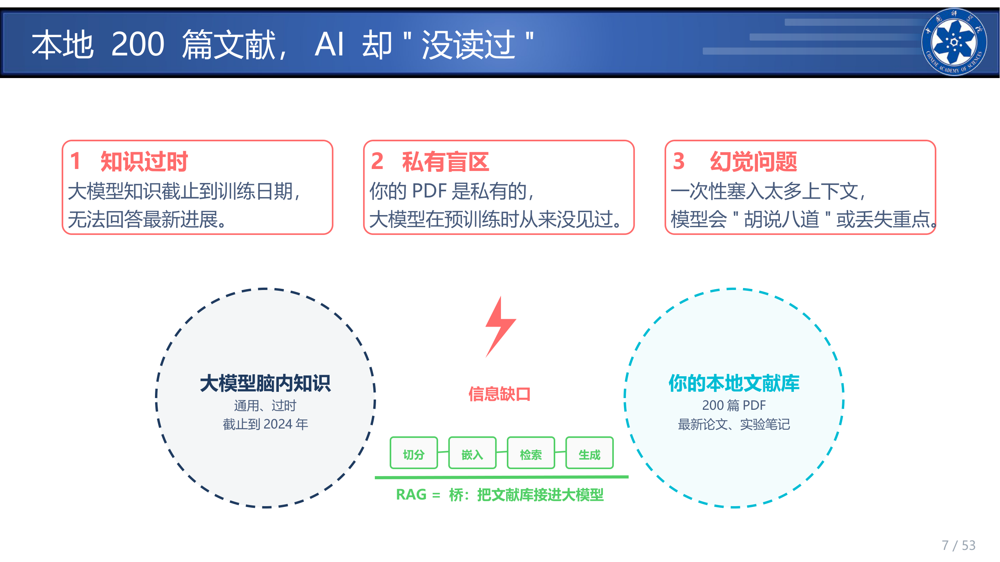

*本地文献库有 200 篇 PDF，但模型「没读过」——缺的不是容量，是桥。*

06 讲开头列了三个缺口（06-P7）：知识过时，模型的参数训练完就冻结，知识停在训练日；私有盲区，你的 PDF 是私有的，预训练时从没见过；幻觉，一次性塞入太多上下文，模型会胡说，或者丢掉重点。

很多人已经在用「文件夹 + AI 助手」凑合：按章节分夹，绪论一夹、方法一夹、正文一夹。课件对这个做法的评价很有意思——**它本质上也是一种检索增强，只是没分块、没索引**（06-P4）。AI 只看得到标题，没读过内容；每次提问都要全量重读，慢、费 Token、定位不准。

知识库要做的，是把你已有的习惯做到位：文献提前解析、切分成片段，提问时精准召回对应片段，毫秒级检索，答案可溯源到原文段落（06-P4）。

RAG 就是这座桥。四段：切分、嵌入、检索、生成。

## 二、把论文变成坐标

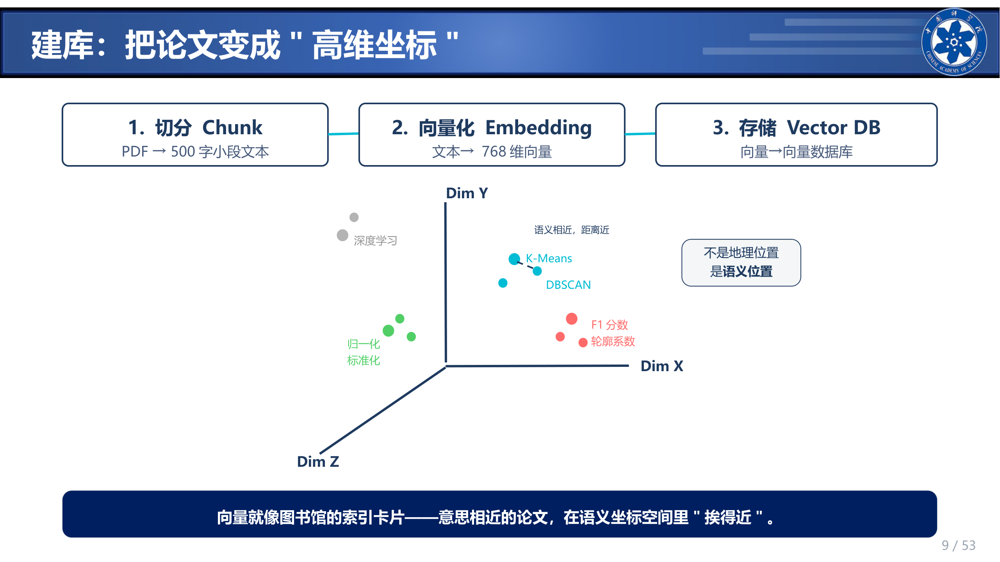

*切分 500 字/段、编码成 768 维、存进向量库；「不是地理位置，是语义位置」。*

建库只有三步（06-P9）：把 PDF 切成 500 字左右的小段；把每段文本编码成 768 维向量；把向量存进向量数据库。

关键在第二步的含义：**向量不是标签，是坐标**。意义相近的文本在向量空间里「挨得近」，所以「苹果」和「Apple」可以靠得很近，哪怕字面完全不同。课件特意标注了一句「不是地理位置，是语义位置」——这张三维图很容易被误读成地理坐标，其实它只是把「语义接近」画成了「空间接近」。

检索则是反过来的路（06-P10）：把问题也编码成 768 个数字，在向量空间里找最近的点，取 Top-K（通常 3–5 个片段）。课件给的示例相似度是 0.92、0.89、0.85。

这里有个容易滑过去的细节：**相似度只是排序依据，不是可信度**。0.92 说明这段话和你问的语义接近，不说明它是对的、也不说明它出自权威版本。后面所有的「可溯源」设计，都是为了补上这一层。

## 三、一次检索的完整旅程

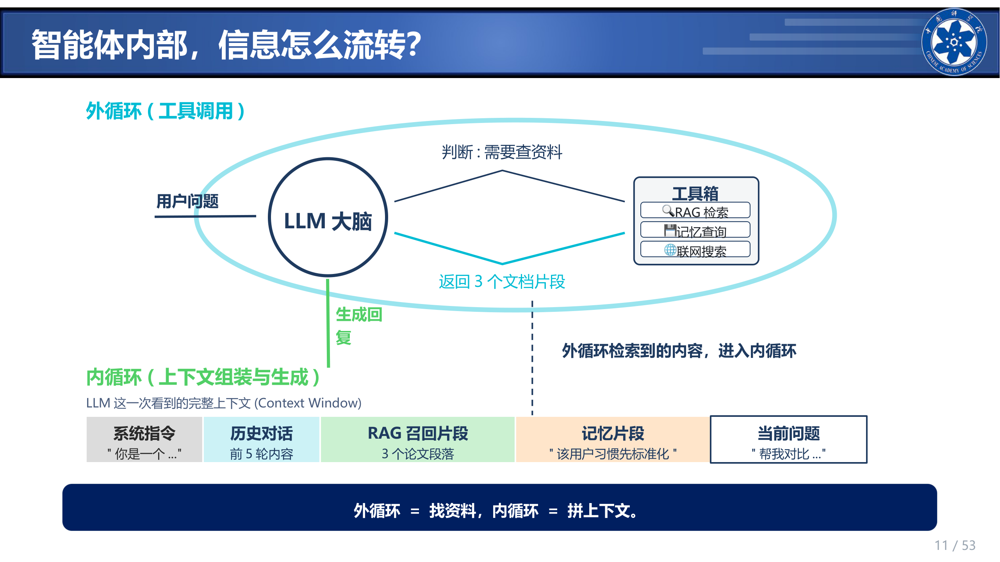

06-P11 把智能体内部拆成两个循环，这张图值得反复看。

外循环是工具调用：用户提问，LLM 判断「需要查资料」，去工具箱里调 RAG 检索、记忆查询或联网搜索，拿回三个文档片段。内循环是上下文组装：系统指令、前 5 轮对话、RAG 召回片段、记忆片段、当前问题，一起拼成模型这一次能看到的完整上下文。

课件的总结只有一句：**外循环 = 找资料，内循环 = 拼上下文。**

两个推论：

第一，检索质量与上下文预算是一对矛盾。召回越多越全，挤掉的历史与指令也越多；拼不下的部分会被截断，而且是静默截断。

第二，RAG 和记忆是两个并列的工具，不是父子关系。这解释了为什么 06 讲后半段要单独讲记忆——记忆不是 RAG 的一个功能，而是另一个知识来源。

如果把这条链和 Task1 的 Harness 对上：外循环就是「调用工具」，内循环就是「整理上下文」。**RAG 不是产品，是 Harness 工具箱里的一个工具。**

## 四、从图书管理员到研究助手

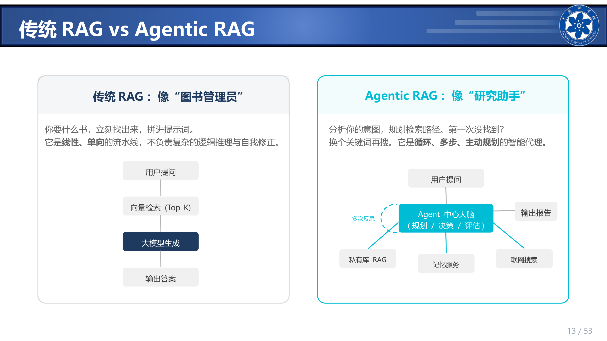

传统 RAG 像图书管理员：你要什么书，他立刻找出来，拼进提示词。线性、单向，不负责复杂推理，也不自我修正。

Agentic RAG 像研究助手：先分析你的意图，规划检索路径；第一次没找到，换个关键词再搜；多轮之后综合成报告。06-P14 的时序图把「记忆 + 知识库」的配合演了一遍：

```text
用户：根据我昨天说的标准，评估这个新方案
Agent → search_memory("评估标准")    → 用户要求 ROI>30%
Agent → search_rag("新方案 ROI 数据") → 方案 B 首年 ROI 预计 35%
Agent → 方案 B 满足您 ROI>30% 的标准 …
```

不先查记忆，就不知道「标准」是什么；不查文档，就不知道方案的 ROI。**答案的每个前提都能指认来源**——30% 来自记忆，35% 来自文档。这才是「可审计」的含义。

值得注意的是，Agentic RAG 变强的地方不在模型，而在多了「检索策略」这一层。代价也在这里：多轮检索会推高成本，还可能陷入「检索表演」——反复换词查，却始终不收敛。Task1 里 Harness 的次数与时间边界，防的正是这个。

## 五、效果上限在入库之前

课件列了三个现场高频现象（06-P17）：化学式、公式类提问召回失败；表格内容答非所问；扫描版 PDF 几乎搜不到。

归因很干脆：**效果上限由数据预处理决定，不在检索算法，也不在模型大小。** 垃圾进，垃圾出。

课件推荐的工具是 MinerU：把 PDF 转成结构化 Markdown，公式与表格识别准确，解析结果可直接入库。再做一步，成熟工具（如 TiMEM Space）可以一键管理：建主题库、上传自动解析、问答带引用溯源、共享给团队（06-P18）。

再往上还有一张进阶清单（06-P20）：切分加 overlap、Embedding 选型与微调、Reranker 精排、向量库选型、GraphRAG / LightRAG。课件明确说「今天不展开，遇到瓶颈时回来按这张图逐项排查」。

我自己的补充：科研 PDF 还有两个坑。双栏排版容易读串行；参考文献列表会被当成正文召回。预处理阶段就该把「页码 + 版面块类型（正文/图表/参考文献）」一起留下，否则引用只能落到「某篇 PDF」，落不到「哪一页哪一段」。

## 六、档案柜与人脑

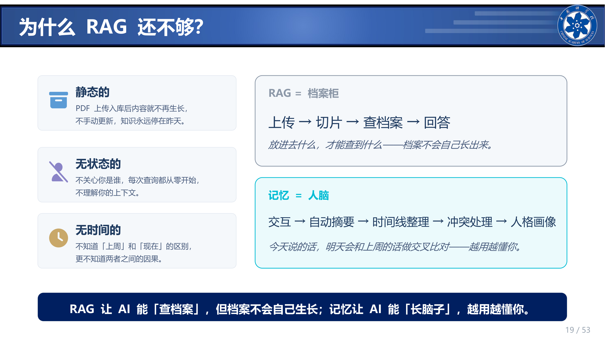

RAG 有三个做不到（06-P21）：

- **静态**：PDF 入库后不再生长，不手动更新，知识停在昨天。
- **无状态**：不关心你是谁，每次查询都从零开始。
- **无时间**：不知道「上周」和「现在」的区别，更不知道两者之间的因果。

课件的比喻很清楚：RAG 是档案柜，放进去什么才能查到什么；记忆是人脑，交互 → 自动摘要 → 时间线整理 → 冲突处理 → 人格画像，越用越懂你。

于是有了那张分工表（06-P23）：

| 维度 | RAG（查资料） | 记忆（记经历） |
| --- | --- | --- |
| 管理对象 | 文献、PDF、公共资料 | 交互历史、决策与实验进展 |
| 关心「你」吗 | 不关心，谁查都一样 | 动态、个人、依赖上下文 |
| 数据更新 | 主动上传新 PDF | 每次对话自动写入、提炼 |
| 典型问题 | 「K-Means 原理是什么？」 | 「我习惯用什么预处理方法？」 |

06-P22 画了一个「协同区」：文献找 RAG，实验找记忆，两者一起回答「根据我的实验和文献，下一步试什么？」。图书馆谁进去借都一样，笔记本上全是你的笔迹。

记忆本身有三种存储形态（06-P25）：知识库型（静态、只读）、文档型（Markdown/JSON，记录交互）、图谱型（实体—关系—实体，随交互生长）。课件顺带纠正了一个误解：**RAG 是统一的检索层，不是一种记忆存储类型。**

文档型与向量化各有软肋（06-P26、P27）：

- Markdown 目录完全可读可编辑，能进 Git，能整份塞进 System Prompt；但没有语义检索，只能关键词匹配，规模一大就超 Token 上限。
- 向量库语义匹配强、能扛海量数据；但人类不可读、改一句要重新嵌入。

所以课件给的结论是混合架构（06-P28）：MD 存核心规则与画像，向量库存海量轨迹。我的理解是，这个选择的本质不是技术偏好，而是「谁维护、怎么排错」——MD 能被 `git diff` 看见，向量库不能。

## 七、三层颗粒度

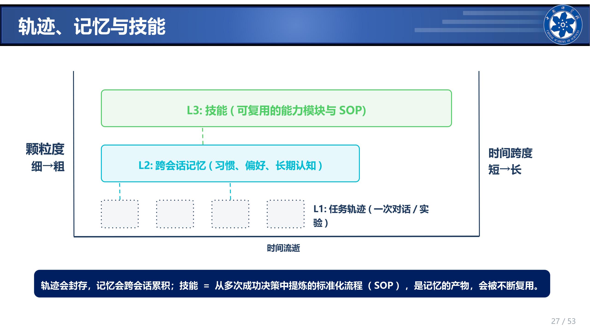

06-P29 画了一条从细到粗、从短到长的轴：L1 任务轨迹（一次对话或实验）、L2 跨会话记忆（习惯、偏好、长期认知）、L3 技能（可复用的能力模块与 SOP）。

课件的原话是：**轨迹会封存，记忆会跨会话累积；技能是从多次成功决策中提炼的标准化流程，是记忆的产物。**

这句话把 Task1 和 Task2 接上了：Skill 是记忆的最高抽象层。一次成功的运行先变成轨迹，轨迹沉淀成记忆，多次记忆再提炼成 Skill。

人脑的类比也在这（06-P31）：感觉记忆对应上下文窗口，工作记忆对应会话缓存，长时记忆对应时序记忆树。课件说「不是在造数据库，是在给数字生命体造海马体」。

## 八、记忆的代谢

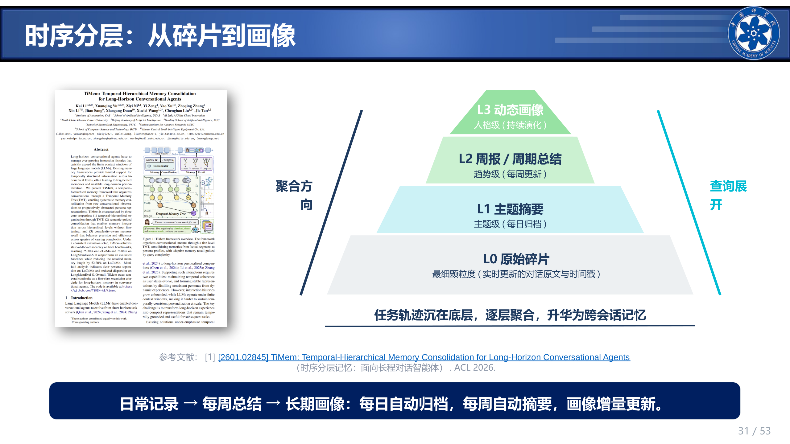

记忆不是仓库，是代谢。写入是一条层层提纯的流水线（06-P34）：

```text
原始交互 100%（高噪声）
  → 主题摘要 30%（去噪留干）
  → 每日归档（时间线整理）
  → 趋势总结（周期性回顾）
  → 人格画像 5%（核心认知）
```

信息密度递减，抽象层级递增。存的介质也分开：原始对话进向量库，摘要进结构化 JSON，画像进 Markdown。

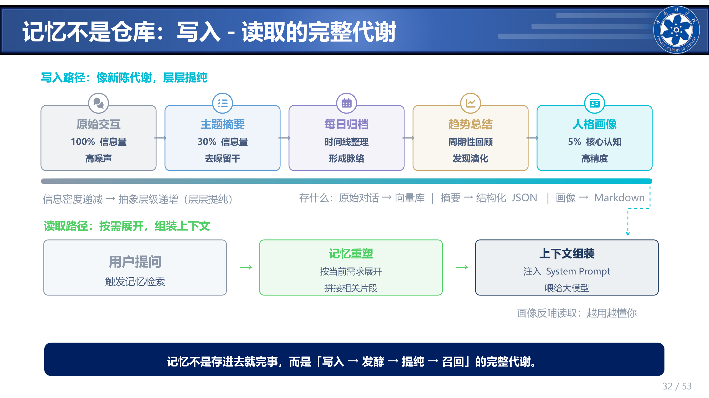

*写入层层提纯（100%→5%），读取按需展开，最后组装进上下文。*

读取则反过来：提问触发检索，记忆重塑按当前需求展开片段，组装进 System Prompt，喂给模型。

「记忆重塑」是这张图里最实用的一步（06-P35）。召回 10 条记忆，里面混着「周三吃火锅」这种噪音，要经过三道过滤：

1. 相关性——扔掉无关的；
2. 融合去重——合并重复；
3. 时间排序——理清先后。

最后留下 5 条精炼记忆。课件的结论是：**搜出来还不够，要筛选才有效；召回只是第一步，过滤整理才决定上下文质量。**

## 九、记忆会打架

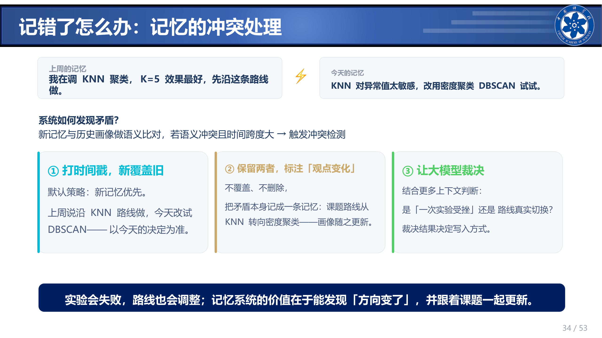

*记忆系统最像科研的部分，是冲突处理（06-P36）。*

上周的记忆说：在调 KNN，K=5 效果最好，先沿这条路线做。今天的记忆说：KNN 对异常值太敏感，改用 DBSCAN 试试。

系统怎么发现矛盾？把新记忆与历史画像做语义比对，语义冲突且时间跨度大，就触发冲突检测。然后有三种处理：

| 策略 | 做法 | 代价 |
| --- | --- | --- |
| 打时间戳，新覆盖旧 | 默认策略，以最新决定为准 | 丢掉「为什么改」 |
| 保留两者，标注观点变化 | 把矛盾本身记成一条记忆 | 额外存储与阅读成本 |
| 让大模型裁决 | 判断是「一次实验受挫」还是「路线真实切换」 | 裁决可能错，要留依据 |

课件的落点是：实验会失败，路线也会调整；记忆系统的价值在于能发现「方向变了」，并跟着课题一起更新。

我的不同意见在这里：科研里「路线变更」本身往往就是结论的一部分。默认的「新覆盖旧」最省事，但会把「为什么放弃 KNN」这个最有价值的信息删掉。我倾向于对「方法/参数/结论」三类记忆默认保留两者。

## 十、一份记忆，处处认得你

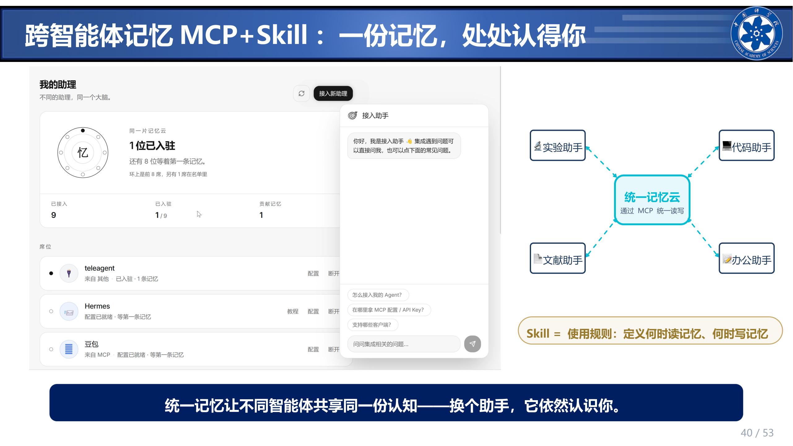

06-P40 的图景是：代码助手、文献助手、实验记录助手、日程助手，各自通过 MCP 连到同一个记忆引擎，背后是统一记忆库、统一知识库、统一工具库。没有 MCP 就各记各的，换个助手就失忆；有了 MCP，接入只需要「服务地址 + 访问密钥」。

06-P42 补了一个关键区分：**Skill 是使用规则，定义何时读记忆、何时写记忆。** MCP 解决「接得上」，Skill 解决「什么时候读写」。

课件还给了一张有/无记忆的对比（06-P39）。同一个 KNN 实验，重开窗口后问「先标准化会不会好点」：

- 无记忆：「标准化通常有帮助，请问你具体在用哪个数据集？」
- 有记忆：「针对你 Iris 上 82% 的问题，KNN 对距离敏感，标准化后权重一致，很可能有效。」

差别不在知识，而在指代消解与上下文继承。回答从「通用模板」变成了「专属建议」。

我的担心是：跨智能体共享把「记忆污染」的面放大了——一个助手写错，所有助手都记错。所以共享记忆必须配写入审计：谁写的、依据什么、能不能回滚。

## 十一、从论文里长出一个数据集

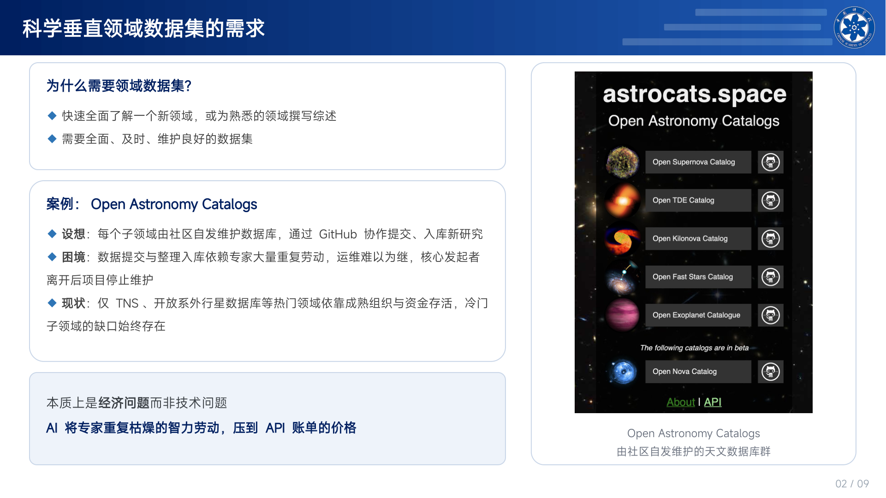

07 讲从一个真实困境开始。想快速了解一个新领域、或者写综述，需要全面、及时、维护良好的数据集。案例是 Open Astronomy Catalogs：设想每个子领域由社区自发维护数据库、用 GitHub 协作提交，现实却是数据入库依赖专家大量重复劳动，核心发起者离开后项目停摆；只有 TNS、系外行星库这类热门领域靠成熟组织与资金活了下来。

课件的判断是：**本质上是经济问题，不是技术问题。** AI 的作用，是把专家重复枯燥的智力劳动压到 API 账单的价格。

这句话解释了 07 讲为什么值得和 06 讲放在一起：知识库是「对内」的，让自己的智能体查得到；数据集是「对外」的，让整个领域不必重建。

## 十二、四代方法：控制权在谁手里

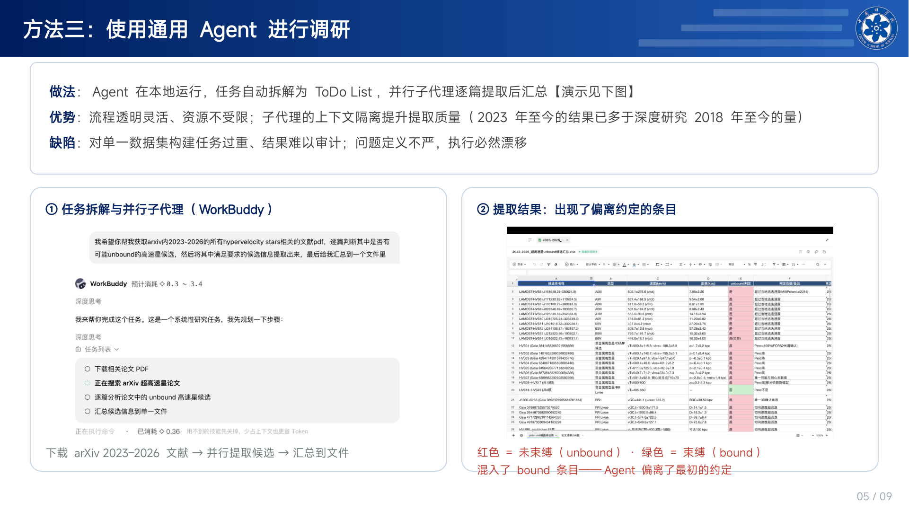

07 讲用同一个任务（从高速星论文里提取候选）比较了四种做法：

1. **单轮聊天机器人**：上传两篇 PDF，一句话说需求，单轮出结果。简单零门槛，但要手动整理，自动化最低。
2. **深度研究功能**：云电脑里的 Agent 自动搜集、分析、出报告。一句话启动，但过程不透明。要求调研 2018 年至今的高速星，报告只收录 21 条，而实际应有上百颗。
3. **通用 Agent**：本地运行，任务拆成 ToDo，并行子代理逐篇提取后汇总。流程透明、上下文隔离提升质量——2023 年至今的结果已经多于方法二 2018 年至今的量。但结果难审计，而且出现了漂移：混进了 bound（束缚）条目，偏离了「只提 unbound」的约定。
4. **自建科研数据 Harness**：自己定义问题，搭「文献 → 数据产物」的工作流，程序化验证每条结果可追溯到原文位置。掌控力最强，代价是搭建耗时——作者的项目连续工作了 4 个月以上。

课件对 Harness 的定义沿用 Task1 的公式：Agent = LLM + Harness。Harness 本义是马具，大模型是力大却难控的烈马，需要一套工程组件约束它按你的需求完成任务（07-P06）。

方法三最有教育意义：子代理的上下文隔离确实提升了单篇提取质量，但**问题定义不严，执行必然漂移**。多出来的那条 bound 记录，不是模型能力问题，是约束问题。

四代不是替代关系，而是按任务规模选。单篇临时提取用方法一就够；只有「领域级、要复用、要发表」的数据集才值得方法四。看到「4 个月」，就该明白它的门槛不是技术，是持续投入。

## 十三、先定义「好」，再谈「准」

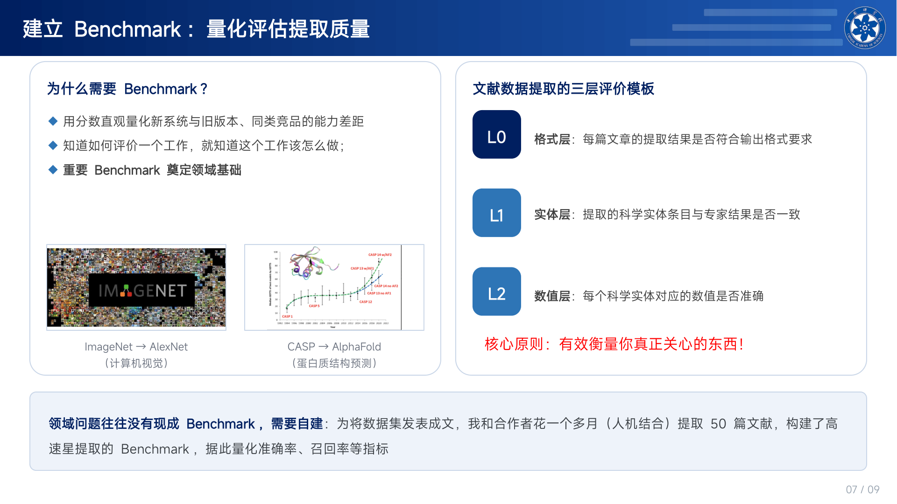

没有 Benchmark，「准确率 90%」是一句没有信息量的话。

07 讲给了一个三层模板（07-P07）：

| 层级 | 检查什么 | 典型错误 |
| --- | --- | --- |
| L0 格式层 | 提取结果是否符合输出格式 | 字段缺失、类型错、JSON 不合法 |
| L1 实体层 | 科学实体条目与专家结果是否一致 | 漏抽、多抽、别名未归一 |
| L2 数值层 | 每个实体对应的数值是否准确 | 单位错、有效数字错、看错列 |

作者与合作者花一个多月（人机结合）提取 50 篇文献，构建了高速星提取的 Benchmark，据此量化准确率、召回率。核心原则只有一句：**有效衡量你真正关心的东西。**

我的理解：三层对应三类误差，修法完全不同。L0 可以完全程序化（schema 校验）；L1 需要实体对齐规则（别名表、同义词）；L2 需要数值容差（单位、精度）。先分层，才知道该修哪里。

## 十四、发布：FAIR 之后还有 AI-Ready

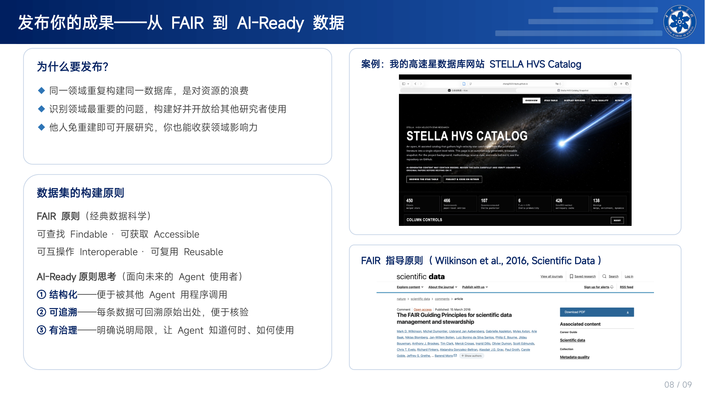

数据集做出来，下一步是发布（07-P08）。理由有三：重复构建同一数据库是资源浪费；识别领域最重要的问题、建好开放；他人免重建即可研究，你也收获影响力。

原则分两层。

FAIR 是经典数据科学的要求：可查找、可获取、可互操作、可复用（Wilkinson et al., 2016, *Scientific Data*）。

AI-Ready 是面向 Agent 使用者的三条补充：

1. **结构化**——便于被其他 Agent 用程序调用；
2. **可追溯**——每条数据可回溯原始出处，便于核验；
3. **有治理**——明确说明局限，让 Agent 知道何时、如何使用。

第三条最容易被忽略，却最影响可用性。没有「适用物种/平台/参考版本/已知偏差」的说明，下游 Agent 会把它当成普适真理——这比数据少几条更危险。

案例是作者的 STELLA HVS Catalog 网站。07 讲最后也提醒，教学用的 Stella-meta 有三条局限：只能取 arXiv 文献并处理 LaTeX；要提取的数据必须存在于文献内；数据结构必须能组织成「独立 id + 若干数值属性」。超出这三条，就得自建。

## 结语

06 讲和 07 讲合起来，是一条从「读到」到「用上」的链：

```text
论文 PDF → 解析 → 切分/嵌入 → 知识库 → 带引用的回答
实验记录 → 写入时间戳 → 分层聚合 → 记忆 → 跨会话的「接着做」
论文表格 → 抽取 → 程序化验证 → Benchmark → 数据集（FAIR + AI-Ready）
```

三者的共同底线只有一条：**每条结论都能回到原文或原始记录的具体位置。** 06 讲的引用页码、记忆的时间戳与冲突标注、07 讲的「每条结果可追溯到原文具体位置」，说的是同一件事。

工具会换，模型会换，这条底线不会。

---

## 资料出处与引用声明

[06pdf]: https://github.com/TashanGKD/panshi-ai4s-practice/blob/main/pdf/06_%E6%99%BA%E8%83%BD%E4%BD%93%E8%AE%B0%E5%BF%86%E4%B8%8E%E7%9F%A5%E8%AF%86%E5%BA%93_%E4%BD%99%E5%AE%A3%E5%BA%86.pdf
[07pdf]: https://github.com/TashanGKD/panshi-ai4s-practice/blob/main/pdf/07_Harness%E5%AE%9E%E8%AE%AD_%E5%BC%A0%E5%81%A5.pdf

- 06 讲：《智能体知识库与记忆》，余宣庆（中国科学院自动化研究所），53 页。
- 07 讲：《Harness 实训：构建科研数据 Harness —— 从科研文献到可信的 AI-Ready 数据集》，张健（中国科学院大学天文与空间科学学院），10 页。
- 文中图片均为官方课件对应页的截图，仅用于个人学习笔记的图注说明；课件、图片与其中引用材料的权利归原作者与权利人所有，如需转载或使用请确认相应授权。页码写法：`06-P11` 指 06 讲第 11 页。
- 课件提到的外部工作：TiMem（arXiv:2601.02845, ACL 2026）、FAIR 原则（Wilkinson et al., 2016, *Scientific Data*）、Stella-meta（github.com/zhang2023-byte/stella-meta）等，链接见 07-P10。
