# Task3 图文笔记：科学模型的训练、选型与可解释设计

> 学习课件：[01 讲 PDF][01pdf] · [02 讲 PDF][02pdf] · [05 讲 PDF][05pdf]；文字版：[Task3 学习笔记](README.md)（表格速查、决策卡、自测与待办）。原文、图片出处与版权声明见文末「资料出处与引用声明」。

Task3 的三讲分别讨论模型训练、模型选型，以及 AI 在科学计算流程中的位置。放在一起看，重点不是某一种网络结构，而是建模前后的一连串判断：数据怎样划分，任务怎样定义，已有知识怎样写进模型，AI 又适合替代计算流程中的哪一步。

一个 R² = 0.94 的结果，可能来自训练集，也可能来自有泄漏的数据划分。即使指标本身没有问题，它也只说明预测较准，不能说明模型解释了科学机理。01 讲《深入理解神经网络原理与模型训练》讲参数怎样学习，02 讲《面向科学场景的数据理解与模型选型》讲训练前需要做哪些判断，05 讲《AI 嵌入的可解释模型设计》则讨论 AI 应该放在科学计算流程的哪个位置。

这篇笔记按课件顺序整理，中间加入一些自己的理解和需要核对的地方。

## 一、从 R² = 0.94 说起


*代码能跑、R² = 0.94、图很好看，这三项都不能单独证明模型可靠。*

01 讲开头给了一个例子：「请你搭建一个 GNN，帮我拟合 @data/ 下的分子数据」。Agent 返回了三项结果：代码能跑、R² = 0.94、散点几乎贴在角线上（01-P7）。课件随后追问：这三项里有几项是真的？GNN 是什么网络？为什么选 GNN？

这三项结果都缺少独立检验。「代码能跑」只说明工程链路通了，不说明科学问题定义正确；R² 没有说明是在哪个集合上计算的；散点图使用的也还是拟合时的数据。按照 01 讲后面的三集划分，这些结果还没有经过测试集评价。

02 讲再次使用这个例子，指出它同时有两类问题：**信息不足；还没理解数据，就先指定了模型**（02-P2）。数据模态、样本单位、科学目标和划分方式都不清楚，直接指定 GNN 没有依据。

所以问题不在于能不能让 Agent 写代码，而在于使用者是否知道该检查什么。课件的表述是：**Agent 时代，代码应该是在知道原理的情况下全权交给 Agent**（01-P7）。这里的「知道原理」，落到实际操作中，就是后面讨论的训练、评估和选型方法。

## 二、模型训练：参数、损失函数与梯度

01 讲从一张房价表开始（01-P9）：一行是一套房（Sample），面积、楼层、朝向是特征（Feature），成交价是标签（Label）。换成科学数据，一行也可以是一种材料、一个分子构型或一条光谱，基本结构不变。

先用线性回归拟合价格和面积：`ŷ = wx + b`。课件给出的定义是：**一个模型，就是一组可以调节的参数**；训练就是从所有参数中选出最优的一组（01-P12）。线性回归有两个参数，Qwen3-8B 有 80 亿个参数（01-P18），但训练的基本过程相同。

接下来要定义什么叫「最优」。每个样本都有残差 `eᵢ = yᵢ − ŷᵢ`，损失函数把多个样本的残差汇总成一个数，用来比较不同参数（01-P13）。

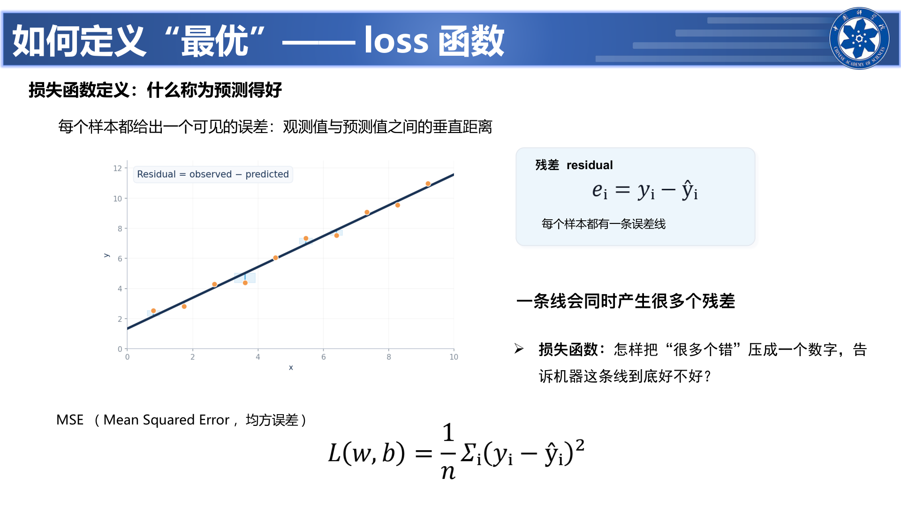

*MSE 对较大误差赋予更高权重，因此几条直线的优劣可以用同一个数比较。*

课件比较了三条候选线，MSE 分别为 10.60、1.29、0.12（01-P14）。在这个例子里，MSE 越小，拟合误差越小。于是，选择直线就变成在参数空间中寻找损失较低的位置。

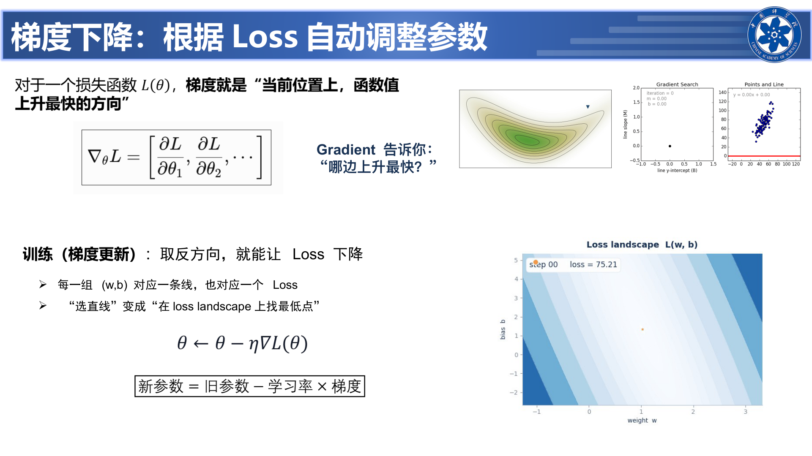

*横轴是 w，纵轴是 b，颜色表示 loss。每组 (w,b) 都对应一条直线和一个损失值。*

梯度下降的参数更新公式是 `θ ← θ − η∇L(θ)`。梯度指向损失上升最快的方向，所以更新时沿反方向走一步（01-P16）。学习率 η 决定步长：太小会稳定但很慢，合适时能较快接近低点，太大则可能震荡甚至发散（01-P17）。

课件的总结是：**「学习」不仅取决于模型和数据，也取决于优化过程本身。** 同样的数据和模型，优化设置不同，结果也会不同。

这里我补充一点：学习率不能根据训练集损失单独选择。训练集损失低，不代表验证集表现好。学习率、模型容量等超参数仍要通过验证集确定，测试集只在方案确定后使用。

## 三、数据划分与预处理边界

01-P10 同时讲了数据预处理和三集划分，这两部分需要放在一起看。

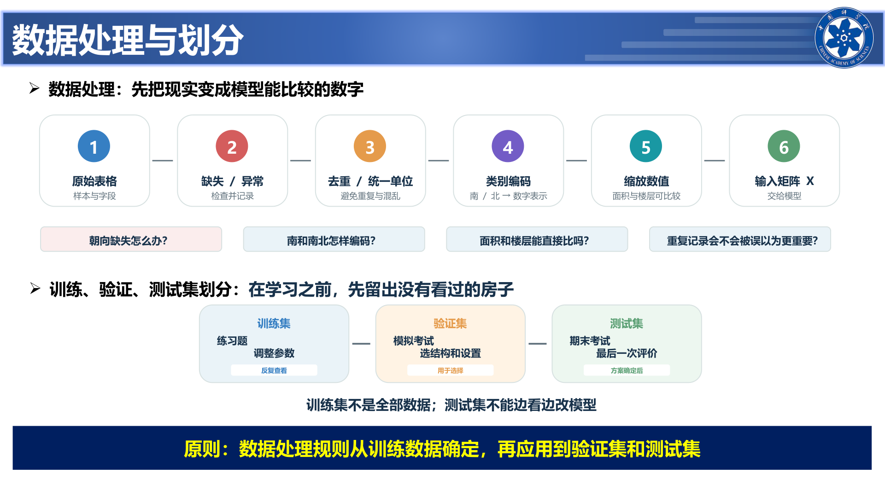

*训练集用于调整参数，验证集用于选择结构和设置，测试集用于最后的独立评价。*

数据处理包括六步：原始表格 → 查缺失/异常 → 去重与统一单位 → 类别编码 → 数值缩放 → 输入矩阵 X。课件为每一步都配了问题：朝向缺失怎么办？南和南北怎么编码？面积和楼层能直接比较吗？重复记录会不会被误以为更重要？（01-P10）

三集的用途分别是：

- 训练集：调整参数，可以反复使用；
- 验证集：选择模型结构和训练设置；
- 测试集：方案确定后的最后评价，不能边看边改模型。

还有一条容易被忽略的原则：**数据处理规则从训练数据确定，再应用到验证集和测试集**。缩放用的均值和方差、缺失值填充值、类别编码表，都只能在训练集上拟合。如果先用全量数据计算这些规则，验证集或测试集的信息就已经进入预处理过程。

科学数据还要额外注意样本是否同源。同一实验、同一体系或同一病人的多条记录，虽然在表格中是不同行，却不一定是独立样本。如果随机分到训练集和测试集，测试结果可能主要来自对相似样本的记忆，而不是对新对象的泛化。

## 四、为什么需要非线性模型

课件列出了线性模型不够用的三种情况（01-P19）：

| 现象 | 例子 | 线性模型的问题 |
| --- | --- | --- |
| 非线性 | 房龄 0→5 与 30→35 的影响不同 | 固定斜率难以表示边际效应 |
| 交互 | 同样 10 ㎡，地段不同增量不同 | 只做加法，不能直接表达特征间的乘积关系 |
| 阈值 | 距地铁的影响在某个距离后突变 | 固定斜率难以表示阈值附近的变化 |

多层感知机通过输入层、隐藏层和输出层组合特征（01-P20）。深度、宽度和连接方式决定模型的表达能力，也决定参数数量。原来由人手工设计的部分特征组合，现在交给训练过程学习。

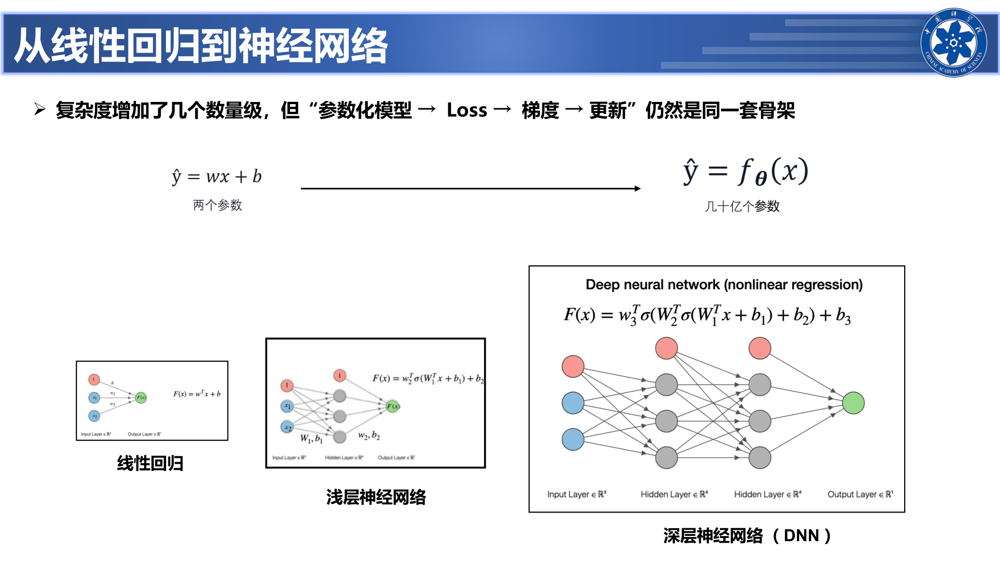

*从线性回归到深层网络，函数形式更复杂，但训练仍包括参数化模型、Loss、梯度和参数更新。*

`ŷ = wx + b` 与 `ŷ = f_θ(x)` 的主要差别是函数族不同。模型复杂度可以增加很多，但「预测 → 计算损失 → 求梯度 → 更新参数」的过程没有变（01-P22）。

## 五、归纳偏置：模型在数据之外依赖什么

01 讲对归纳偏置的定义是：**数据之外的默认偏好，它决定模型更容易学到哪一种解释**（01-P23）。

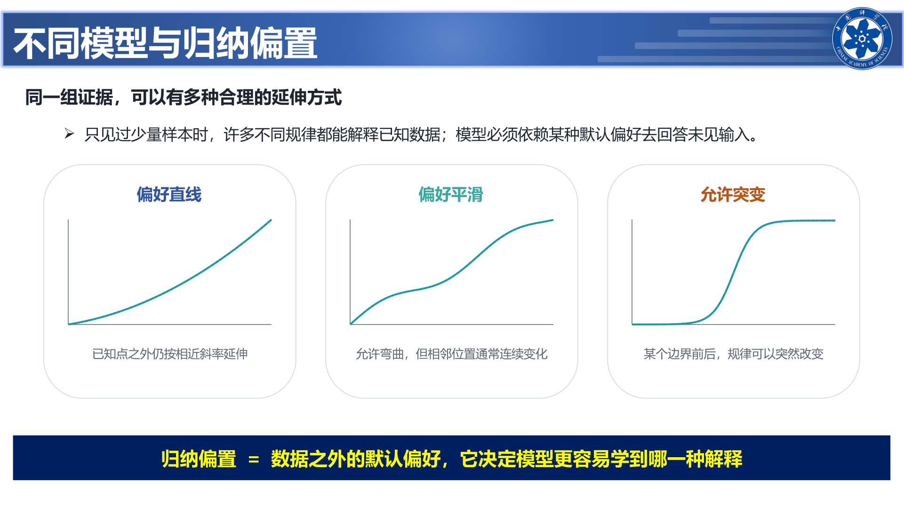

*同一批数据点可以用不同曲线解释。模型选择哪一种，不只取决于数据，也取决于模型结构和训练目标。*

课件进一步给出了先验进入模型的过程（01-P24）：

```text
先验（科学知识：规律与不变量）
  → 表示（数据表示：网格 / 序列 / 图）
  → 约束（结构 / Loss：共享 / 对称 / 守恒）
  → 偏好（归纳偏置：更容易学什么）
  → 验证（未见样本：是否真的泛化）
```

这里最重要的是，先验不会因为我们知道它就自动生效。比如原子编号不应改变分子性质，如果这一要求没有体现在数据表示、网络结构、Loss 或数据增强中，模型仍可能学出依赖编号的规律。

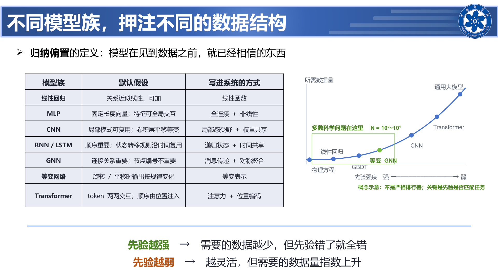

*左侧比较不同模型族的默认假设及实现方式，右侧表示先验强度与所需数据量之间的关系。*

01-P25 对照了线性回归、MLP、CNN、RNN/LSTM、GNN、等变网络和 Transformer。可以先记住两个趋势：

- 先验越强，通常需要的数据越少，但先验错误时会带来系统性偏差；
- 先验越弱，模型更灵活，但通常需要更多数据才能学到合适规律。

课件指出，多数科学问题的样本量在 N = 10² ~ 10⁴。这个量级往往不足以从头训练通用大模型，因此需要利用合适的先验。这里的图是概念示意，不是模型性能排行榜；模型选型要看先验是否匹配任务，而不是只看模型大小或通用 benchmark 排名。

## 六、不同架构怎样交换信息

02 讲接着讨论为什么选择 GNN。它给出的统一视角是：**网络结构的本质，是预先规定「谁和谁交换信息」**（02-P5）。输入相同，但连接方式不同，模型能够利用的关系就不同。

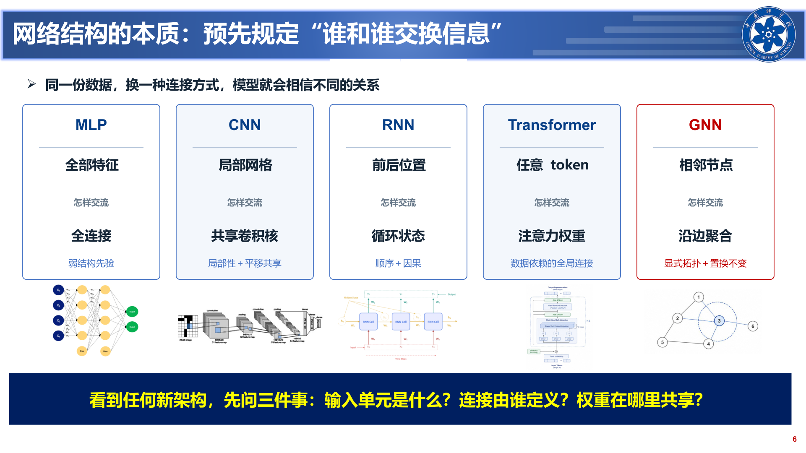

*阅读一种架构时，可以先看输入单元、连接方式和权重共享位置。*

| 架构 | 输入单元 | 连接由谁定义 | 权重共享 | 默认相信什么 |
| --- | --- | --- | --- | --- |
| MLP | 全部特征 | 全连接 | 不共享 | 特征可全局交互 |
| CNN | 局部网格 | 局部窗口 | 同一卷积核滑过全图 | 局部模式可复用、平移等变 |
| RNN | 前后位置 | 循环状态 | 每个时间步复用 | 顺序与因果 |
| Transformer | 任意 token | 注意力权重 | 各层共享投影 | 内容决定的全局连接 |
| GNN | 相邻节点 | 显式边 | 沿边聚合 | 拓扑重要、节点编号不重要 |

课件也解释了这些架构出现的背景。把图像直接拍平会丢失邻域信息，还会使参数量随像素数快速增加。1024×1024 的图接 4096 个隐藏单元，第一层约有 4.3×10⁹ 个参数（02-P8）。RNN 处理的是元素顺序和状态传递（02-P12）；LSTM/GRU 通过门控缓解长链传播中的梯度问题（02-P13）；Attention 和 Transformer 则让每个输出位置按内容选择需要关注的输入，不再只依赖一个固定长度的上下文向量（02-P14、P15）。

GNN 和 PINN 代表了另外两种加入先验的方式：

- **GNN** 使用显式拓扑。没有边连接的对象，默认不直接交换信息（02-P19）。
- **PINN** 的主要变化在损失函数，而不是连接方式：在数据误差之外加入物理方程和边界条件的残差，`L = L_data + λ·L_PDE + μ·L_boundary`（02-P20）。

PINN 的前提是方程可靠。如果方程或边界条件本身不准确，加入 loss 的物理约束也会变成错误约束。这和前面关于先验强度的讨论是一致的。

我觉得「输入单元、连接方式、权重共享」这三问很适合用来读新方法。它能帮助我们把「性能更强」进一步拆成具体原因：模型究竟新增了哪条信息通路，或者减少了哪条不必要的连接。

## 七、数据表示决定了保留哪些关系

02 讲列出六类科学数据（02-P23）：表格/矩阵、图像/网格、序列/光谱、关系图、3D/点云、时空场。对每一类数据，都要先问三个问题：

1. 一个样本是什么？
2. 结构在哪里？
3. 怎样划分？

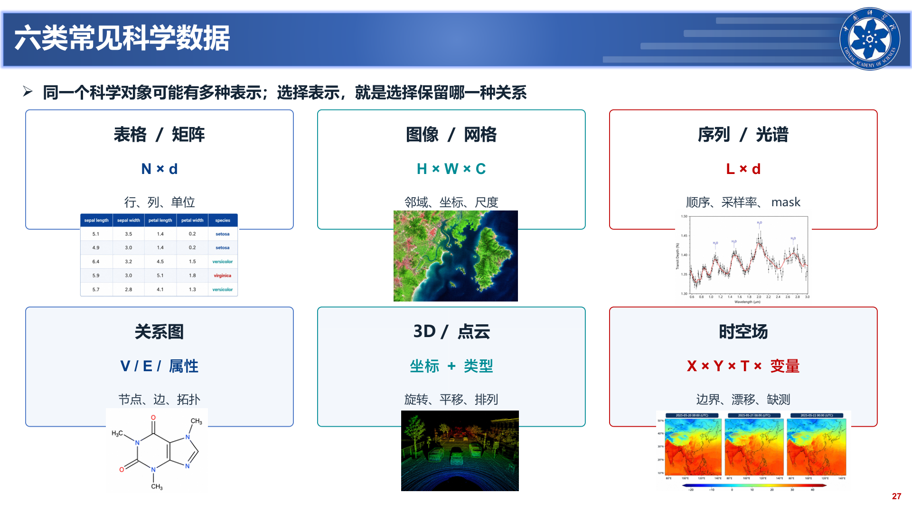

*同一科学对象可以有多种表示。不同表示保留的信息不同，适合的模型也不同。*

| 数据类型 | 需要确认的问题 |
| --- | --- |
| 表格/矩阵 | 矩阵形状相同，不代表科学含义相同；数值化后仍要保留行列语义（02-P24） |
| 图像/网格 | 关键不是文件长得像图片，而是空间坐标、局部邻域与多尺度是否有意义（02-P25） |
| 序列/光谱 | 不能只看长度 L；token 的含义、顺序与采样机制共同决定表示（02-P26） |
| 关系图 | 图不是天然真理；邻居怎样连接、边表示什么，需要领域知识确认（02-P27） |
| 3D 几何 | 核心是对称性：标量常要求不变，方向量可能需要等变（02-P28） |
| 时空场 | 同时存在时间和空间结构；验证方案要分别检查新时间与新地点（02-P29） |

其中「怎样划分」直接关系到评估是否可信。表格数据可能要按来源分组，图像按样品或区域划分，序列按家族、时间或批次划分，图按体系或结构族划分，时空场则要分别考虑时间滚动和空间外推。不能不加判断地随机切分。

课件最后用一张「数据表示说明书」汇总这些信息（02-P30），包括五个字段：样本单位、数据结构、必须保留、对称与变换、标签与质量。

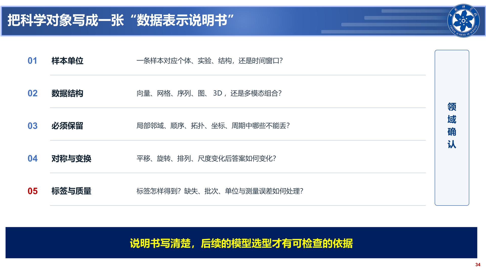

*先写清数据表示，再讨论模型选型，后续的选择才有依据。*

这五栏也可以看成一份建模假设清单。尤其「对称与变换」会直接影响模型应采用不变还是等变表示、loss 是否需要额外约束，以及数据增强可以使用哪些变换。方法部分如果说不清这些选择，往往是因为前期没有把数据表示写清楚。

## 八、模型选型六问与建模任务书

02 讲建议不要一开始就让 Agent 写训练代码，而是先回答「模型选型六问」，形成建模需求说明书，再进入「候选 → 训练 → 验证 → 诊断 → 再选择」的循环（02-P32）。


*左侧是六问，中间是迭代过程，右侧是 Agent 输出和最终交付物。*

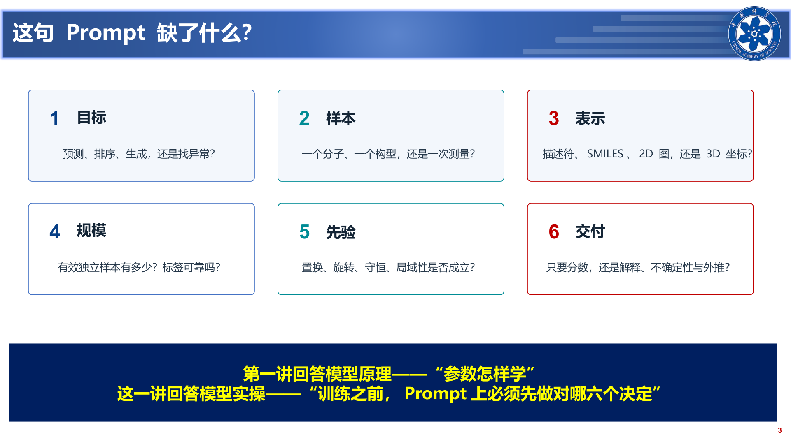

*目标、样本、表示、规模、先验和交付要求，都需要在训练前说明。*

| 问 | 写清什么 | 决定什么 | 典型错误 |
| --- | --- | --- | --- |
| Q1 目标 | 回归/分类/排序/生成/聚类/异常；科学用途 | 输出、损失、指标 | 把筛选当回归做 |
| Q2 样本 | 一行是什么；哪些对象必须分组 | 有效 N、划分独立性 | 同源 1000 条当独立样本 |
| Q3 模态 | 表格/图像/序列/图/3D/场；哪些关系必须保留 | 架构族、token/节点定义 | 拍平成表格 |
| Q4 规模 | 有效 N、标签、缺失、噪声、不平衡 | 容量、正则化、预训练 | N=200 训大 Transformer |
| Q5 先验 | 对称、守恒、单调、局域、机理方程 | 等变、约束损失、机理耦合 | 已知规律不写进模型 |
| Q6 交付 | 精度、解释、不确定性、外推、成本 | 黑箱可否接受、验证场景 | 需要解释只给黑箱分数 |

Q1–Q6 的表述与错误示例见 02-P33 ~ P38，决策卡汇总见 02-P39。

Q1 和 Q6 值得单独说明。Q1 决定 loss 和评价指标。药物候选筛选真正关心的可能是前 1% 的排名，RMSE 尚可的模型也可能排序很差（02-P33）。如果把筛选问题直接写成回归，评价指标就可能偏离实际用途。

Q6 决定除了精度之外还要交付什么。例如实验排队资源有限时，模型除了预测，还应提供不确定性，帮助决定下一次测什么（02-P38）。如果任务需要机理解释，只交付一个黑箱分数也不够。

02-P40 给出了 Prompt 骨架，整理如下：

```text
请先不要直接写训练代码；若信息不足，先列出需要我或领域专家确认的问题。
Q1 目标：预测［具体性质］，属于［回归/分类/排序］；科学用途是［筛选/定量/解释］。
Q2 样本：确认一行对应分子还是构型；同一实体必须分组划分。
Q3 模态：比较描述符、SMILES、2D 图、3D 坐标各自保留/丢失的信息。
Q4 规模：报告有效独立 N、标签数、缺失、噪声与重复；不要把同源记录当独立样本。
Q5 先验：确认置换、旋转/平移不变或等变、局域性与其他机理约束。
Q6 交付：除精度外报告不确定性、外推、可解释性与推理成本。
请输出：数据审计 → baseline → 候选模型族与理由 → 划分/指标 → 风险与复现实验。
```

02-P32 右侧还有一份填写好的「建模需求说明书」：用合金组分预测析氢过电位，从 5000 个候选里挑 20 个做实验。其中有几项很值得参考：

- 任务写的是「回归，但真实用途是排序」，Top-20 命中率优先于 RMSE；
- 数据是定长表格、13 维数值特征，明确说明无空间/时序/图结构，因此不需要 CNN / RNN / GNN；
- 主指标是 Spearman ρ 与 Top-20 EF，辅助指标 RMSE 要与 ±15 mV 的实验误差一起解释；
- 不得随机划分，不得在全量数据上做标准化或特征选择。

这份示例把目标、样本、数据结构、指标和禁止事项放在了同一份任务书里，后面检查 Agent 的输出时也有明确依据。

另外，baseline 应该是必答项。没有 baseline，就很难判断复杂模型带来的提升是否值得，也无法排除任务本身过于简单的情况。

六问的顺序可以按领域调整，但我认为 Q2 应在 Q4 之前。先定义什么算独立样本，再统计有效 N；如果顺序反过来，同源记录很容易被重复计数。

## 九、预测准确不等于理解机理

05 讲从科学理论与数值求解的区别开始。课件引用庞加莱和爱因斯坦的话（05-P2）：科学关注恒常关系，也试图用尽可能少的基本概念和关系理解经验之间的联系。随后用两个例子说明「理论」和「求解」并不相同（05-P3、P4）：苹果落地与月球绕地可以由万有引力解释；但知道 Navier–Stokes 方程，不代表能低成本算出具体流场。

AI 在这里主要帮助求解，而不是替代理论。05-P5 用 CFD 对比了两种做法。

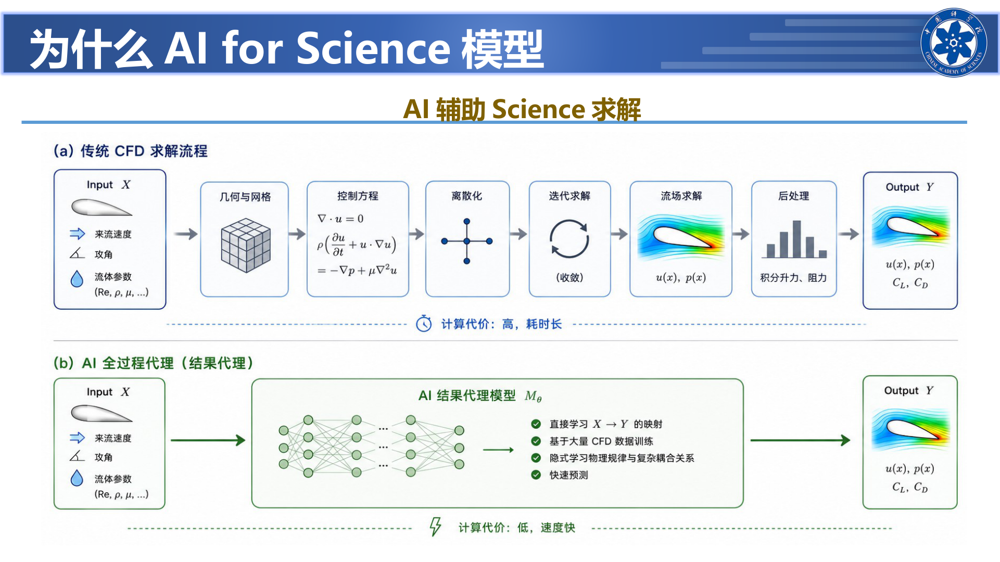

*传统流程依次处理几何与网格、控制方程、离散化、迭代求解和后处理；AI 结果代理直接学习 X → Y。*

传统 CFD 的每个步骤都有明确物理含义，但计算成本高。AI 结果代理通过一次前向计算给出结果，速度快，但中间物理过程不再显式出现。前者主要保留过程，后者主要学习输入与结果之间的映射。

课件随后讨论 AlphaFold2（05-P7 ~ P9）。AF2 可以从序列信息预测蛋白质三维结构；按 01-P6 的介绍，它在 CASP14 上达到原子级预测精度，被认为解决了困扰生物学界 50 年的「蛋白质折叠问题」。但 2017 年诺贝尔化学奖得主 Richard Henderson 在 *Science* 的评论中指出：

> "solving the protein-folding problem means making accurate predictions of structures from amino acid sequences starting from first principles based on the underlying physics and chemistry."

课件在「预测结构」周围列出了四个问题：折叠机制？化学精度？动态构象？实验验证？结论是：**科学机理的可解释性，依旧未确定**（05-P9）。

这个例子说明，预测和机理解释需要分别评价。模型能给出准确结构，不等于它已经解释折叠过程。05 讲接下来讨论的问题因此不是单纯提高精度，而是：**AI 模型在科研流程的哪些部分可以嵌入？如何嵌入？**（05-P11）

## 十、DFT 流程的节点与循环

要判断 AI 可以嵌入哪里，需要先把原有计算流程拆开。05 讲选择了 DFT 自洽计算作为例子。

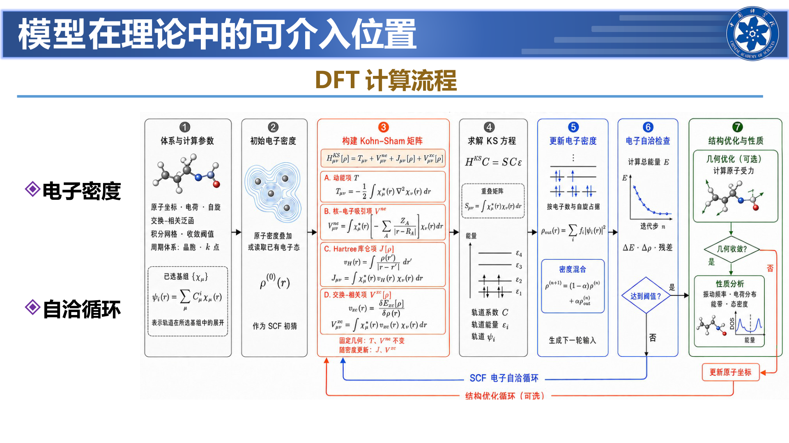

*① 体系与参数 → ② 初始电子密度 → ③ 构建 Kohn–Sham 矩阵 → ④ 求解 KS 方程 → ⑤ 更新电子密度 → ⑥ 自洽检查 → ⑦ 结构优化与性质；内圈 SCF，外圈几何优化。*

看图时主要注意三点：

1. **两个循环。** 内圈是 SCF（③→④→⑤→⑥→回到③），反复更新电子密度直到收敛；外圈是几何优化（⑦ 更新原子坐标后回到 ①），可选。
2. **③ 还可以继续拆分。** 构建 Kohn–Sham 矩阵包括动能 T、核–电子吸引 V^ne、Hartree 库仑 J、交换–关联 V^xc。固定几何下前两项不变，后两项随密度更新。
3. **计算成本比较集中。** ③ 需要逐轮构建矩阵，④ 需要反复求解方程；⑥ 如果收敛慢，整个循环都会变慢。

流程拆到这个程度，才能继续判断每个节点完成什么任务、是否适合用 AI 加速或替代，以及替代后会丢掉哪些中间量。

## 十一、AI 在 DFT 中的七个插入点

05-P14 标出了七个位置，并分别说明原有计算的难点和 AI 可能承担的工作。

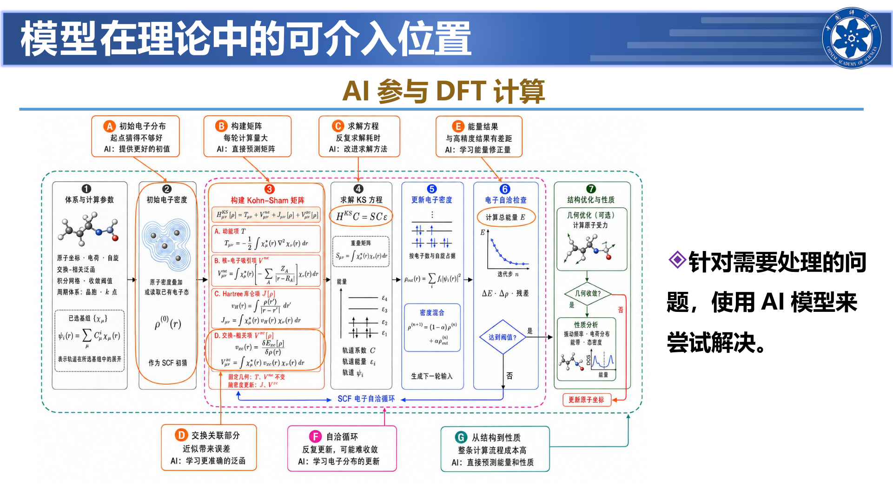

*A 初始电子分布、B 构建矩阵、C 求解方程、D 交换关联、E 能量结果、F 自洽循环、G 从结构到性质。*

下面按保留机理的多少重新排序。这个顺序是我的整理，不是课件原图：

| 级 | 插入点 | 这一格原本在算什么 | AI 替换成什么 | 保留的机理 | 风险 |
| --- | --- | --- | --- | --- | --- |
| A | 初始电子分布 | 原子密度叠加或读已有电子态 | 更好的初值 | 几乎全部 | 初值差只影响速度，不影响收敛结果 |
| C | 求解方程 | 解 `H^KS C = S C ε` | 改进求解方法 | 几乎全部 | 精度/稳定性 |
| B | 构建矩阵 | 四项积分，逐轮重算 | 直接预测矩阵 | 大部分 | 矩阵必须满足对称/物理约束 |
| D | 交换关联 | 近似泛函带来误差 | 学更准确的泛函 | 大部分 | 泛函误差会进 SCF，可能不收敛 |
| E | 能量结果 | 高精度与低精度之间差一个 ΔE | 学能量修正 | 中 | 修正量外推不可靠 |
| F | 自洽循环 | 反复更新电子密度 | 学密度更新规则 | 少 | 收敛性无保证 |
| G | 从结构到性质 | 整条流程算能量/力/性质 | 直接预测 | 几乎没有 | 机制缺失，外推风险最大 |

越靠近 A，AI 越像原有方法的加速工具；越靠近 G，越接近用数据驱动模型替代整条计算流程。可解释性的差别不只来自网络结构，也来自 AI 所替代的位置，以及原有理论的中间量是否保留。

课件用四个代表工作说明这些方法（05-P22 ~ P28）：

| 工作 | 做了什么 | 落在哪一级 | 用的模型 |
| --- | --- | --- | --- |
| SchNOrb | 预测哈密顿量矩阵与重叠矩阵，辅助加速自洽计算 | B（构建矩阵） | 基于 SchNet 的消息传递 GNN |
| NeuralXC | 学 PBE 与 CCSD(T) 之间的能量差，提高精度并提供势修正 | D/E（泛函/能量修正） | Behler–Parrinello 型原子网络（MLP） |
| NequIP | 从原子结构预测能量与力，构建机器学习势 | G（结构→性质） | E(3) 等变图神经网络 |
| FermiNet | 用满足反对称性的网络表示多电子波函数，VMC 求基态能量 | 另一个方向（替代波函数表示） | 置换等变的全连接网络 |

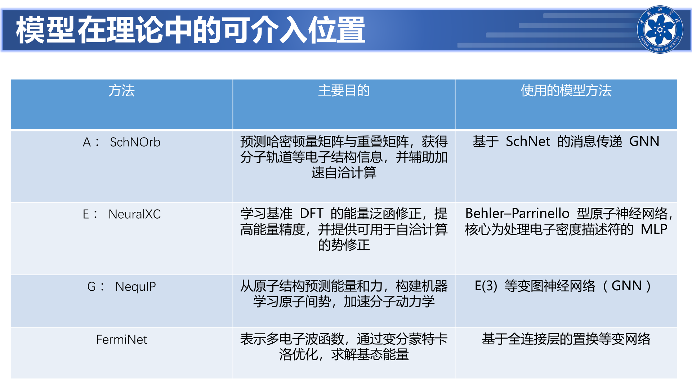

*课件原表用 A、E、G 标注部分方法，FermiNet 单独列出。*

> **需要核对的一点**：课件表格用 A/E/G 标注，但按 05-P14 的定义，SchNOrb 实际替换的是「③ 构建矩阵」（B），NeuralXC 对应「D 交换关联 / E 能量修正」，NequIP 对应「G 从结构到性质」。字母与实际位置并不严格一致。这里应以方法实际替代的节点为准，暂时不确定课件是笔误还是采用了另一套标记。

NeuralXC 的做法值得单独看，因为它不是直接预测完整能量。

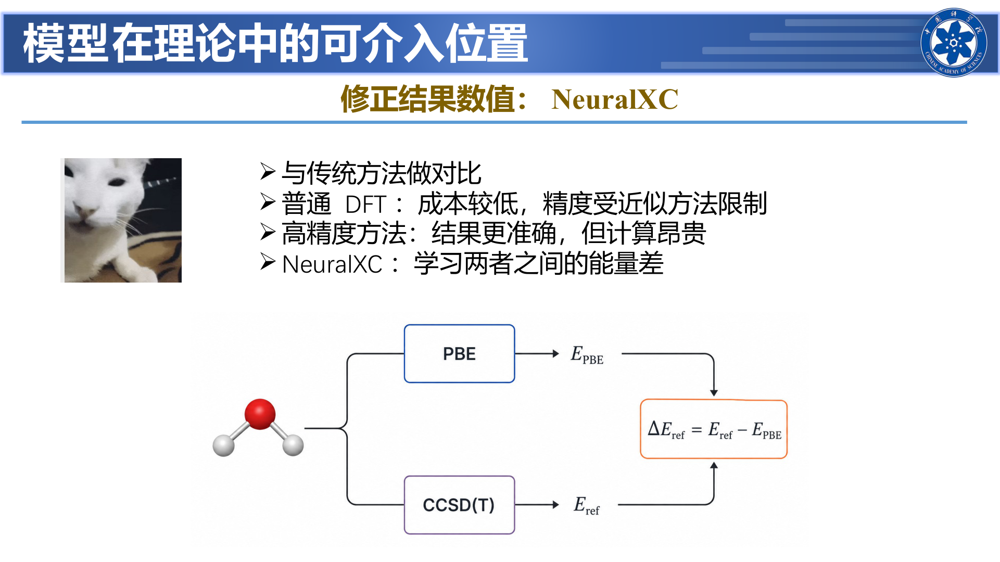

*同一个分子分别用 PBE 和 CCSD(T) 计算能量，网络学习 ΔE_ref = E_ref − E_PBE。*

网络只学习低成本方法与高精度方法之间的差值。这个差值通常比总能量更小、更平滑，因此有限数据下更容易学习。已知的低成本计算方法保留在模型外，神经网络负责补充误差项。

这和 01 讲的残差有相似之处，但用途不同。01 讲中残差用于计算 loss，NeuralXC 中两种方法的差值本身就是学习目标。对科学建模来说，这种 Δ 学习往往比直接从零预测完整结果更省力，也更容易保留已有理论或计算方法的作用。

## 十二、过程建模与结果建模的取舍

05-P29 把前面的分析整理为四步：

1. 传统科学计算流程完全展开；
2. 对每一个任务节点做界定，判断完成什么任务；
3. 猜想哪些环节适合使用 AI 进行替代和优化；整个流程有没有可能被 AI 优化；
4. 试验和验证。

第 3 步不仅包括单个节点，也包括整条流程。选择替代哪一部分，需要同时考虑计算收益、机理保留和外推风险。


*过程建模保留规律与中间状态，结果建模直接学习输入到输出的映射。*

课件的总结是：**现代科学模型的发展，本质上是在可解释的过程与高效的结果预测之间寻找平衡**；如何解决这个二元矛盾，可以成为一个值得研究的方向（05-P30）。

后面的三个例子对应不同程度的保留与替代。

**Pitzer 模型**（05-P32）：溶液自由能修正 ≈ 长程静电项 + `B c²` + `C c³`。第一项是确定已知项，描述整体电荷环境；第二、三项是展开项，分别对应两两相互作用和三体共同影响。

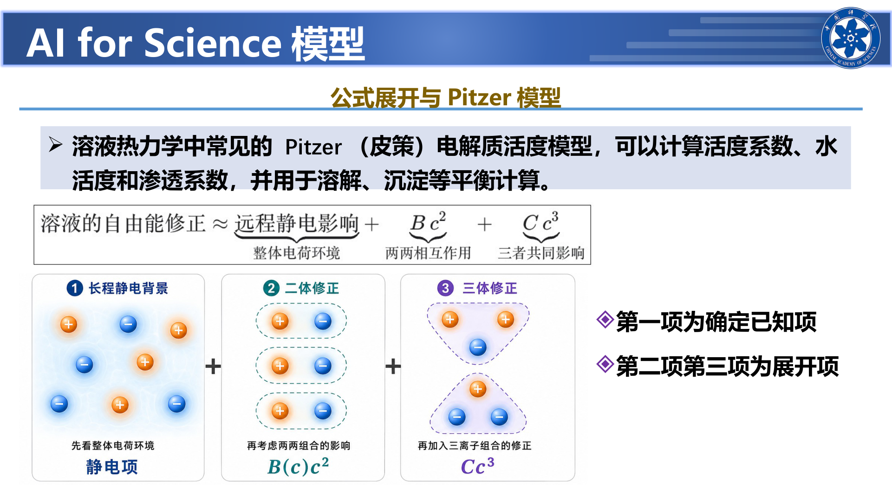

*已知物理项保持显式形式，模型主要处理难以写出闭式解的展开项。*

**多层模型展开法**（05-P33）也采用展开逼近，但课件标注了「适用范围尚未确认」，使用时需要额外验证。

**全流程替代**（05-P34）直接用网络从分子坐标预测能量，速度更快，但中间物理过程不再显式保留。

前两个例子的共同点是固定已知项，只让模型处理未知或难算的部分。可解释性主要来自模型设计时保留了哪些理论量，而不是事后给黑箱增加解释。第三个例子则说明，全流程替代虽然能降低成本，也会失去原有中间过程。

## 十三、评价结果的三个层面

三讲放在一起，可以从三个层面检查一个模型结果：

| | 01 讲 | 02 讲 | 05 讲 |
| --- | --- | --- | --- |
| 关注对象 | 一组参数 | 一类结构 | 一个流程里的位置 |
| 主要依据 | 独立测试集上的 loss | 六问 + 表示说明书 + baseline | 插入点保留的机理 + 独立验证 |
| 典型失败 | 测试集泄漏、学习率/容量乱选 | 同源样本当独立样本、黑箱交付 | 用结果建模冒充机理理解 |
| 核心问题 | 在没看过的数据上还准吗 | 这个任务定义对吗 | 它替掉的那一格，你还需要吗 |

我自己的检查顺序是：

1. **预测是否可靠**：指标是否来自一个从未参与任何选择的集合？训练集 R²，或者反复查看并调参的测试集，都不能作为最终独立评价。
2. **任务是否定义正确**：指标是否对应实际科学用途？Top-1% 命中率与 RMSE 不是一回事（02-P33），筛选问题不能只用回归误差评价。
3. **机理是否得到支持**：模型的中间量能否被独立测量或独立计算检验？如果不能，特征重要性或事后归因只能提供线索，不能直接等同于机理解释。

AlphaFold2 的例子中，前两条基本能够成立，第三条仍是开放问题（05-P9）。因此「模型很准」不能直接推出「我们理解了机理」；反过来，理论上有解释，也不保证某个具体模型一定准确。

## 十四、训练前、中、后的检查表

我按实际使用顺序整理成下面三张清单，括号内是对应课件页码。

**训练前**

- [ ] Q1 目标：这是回归、分类、排序还是生成？科学用途是什么？（02-P33）
- [ ] Q2 样本：一行是什么？哪些对象必须分组？（02-P34）
- [ ] Q3 模态：哪些关系必须保留？拍平会丢什么？（02-P35）
- [ ] Q4 规模：有效独立 N 是多少？标签贵不贵？（02-P36）
- [ ] Q5 先验：哪些规律绝不该被违反？（02-P37）
- [ ] Q6 交付：要不要不确定性、解释、外推？（02-P38）
- [ ] 数据表示说明书五栏是否填完？（02-P30）
- [ ] 划分单位是否等于科学独立性？规则是否只在训练集上拟合？（01-P10）

**训练中**

- [ ] baseline 是什么？（均值/线性/树模型；02-P32）
- [ ] loss 与 Q1 是否一致？（01-P13、02-P33）
- [ ] 学习率是否用验证集选？（01-P17）
- [ ] 验证集是否只用于「选结构和设置」？（01-P10）

**训练后**

- [ ] 测试集是否一次都没参与选择？（01-P10）
- [ ] 指标是否对应科学用途？（02-P33）
- [ ] 有没有不确定性？外推边界写清楚了吗？（02-P38）
- [ ] 需要机理解释时，插入点选在哪一级？（05-P14）
- [ ] 中间量能否被独立检验？（05-P9）

## 十五、习题与动手

**一、读图题**

1. 用 01-P25 的表，给自己的课题选一个先验强度合适的模型族，并写出理由。重点说明它的默认假设是否符合数据，而不是笼统地说哪个模型更强。
2. 用 02-P5 的三问，拆一个熟悉的架构（任选 ResNet、GAT、ViT），各写一句话。

**二、动手题**

3. 造一份 60 行的小表格，跑线性回归与两层 MLP，把学习率设成 0.001 / 0.1 / 10 三档，画 loss 曲线，观察稳定但慢、正常收敛和震荡三种情况（对应 01-P17）。
4. 在同一份数据上做一次正确划分，再做一次同一实体跨训练集和测试集的随机划分，记录两次测试指标的差异，直接观察泄漏的影响（对应 01-P10、02-P34）。
5. 用 02-P40 的骨架写一份六问 Prompt，让 Agent 先输出数据审计、baseline 和候选模型族，再决定是否写训练代码。

**三、流程拆解题**

6. 选一个自己领域的计算流程（DFT、MD、CFD、反应网络、气候模式均可），画出 5~9 个节点，标出循环，再按 05-P14 的 A–G 逐格判断：这一格是否值得用 AI 替代？替代后会失去哪个原本可计算的中间量？
7. 找一个 Δ 学习的例子，说明它学习的是哪部分差值，又把哪一部分先验或已有计算方法保留在模型外（对应 05-P23、P32）。

## 十六、待办

- [ ] 看配套三节线上实训录播（本笔记只覆盖 01、02、05 三讲课件）
- [ ] 按「十五」的动手题 3、4 各跑一次，把 loss 曲线和泄漏对照表贴进 exercises/
- [ ] 把「十四」的检查表改写成一页纸，下次开新课题时直接用

## 结语

这三讲分别处理参数、结构和流程位置，但都要求在训练之前把关键假设说清楚。01 讲关注 loss、学习率和数据划分，02 讲关注数据表示、先验和任务定义，05 讲关注 AI 替代了哪个计算节点、保留了哪些理论中间量。

因此，看到 R² = 0.94 时还要继续问：它在哪个集合上计算？对应什么科学任务？模型替代了流程中的哪一步？这些问题没有回答之前，这个数只能说明一部分预测表现，不能说明整个建模工作已经完成。

---

## 资料出处与引用声明

[01pdf]: https://github.com/TashanGKD/panshi-ai4s-practice/blob/main/pdf/01_%E7%A7%91%E5%AD%A6%E6%A8%A1%E5%9E%8B%E5%AE%9E%E8%AE%AD%EF%BC%88%E4%B8%80%EF%BC%89_%E6%9D%8E%E6%96%87%E6%AF%85.pdf
[02pdf]: https://github.com/TashanGKD/panshi-ai4s-practice/blob/main/pdf/02_%E7%A7%91%E5%AD%A6%E6%A8%A1%E5%9E%8B%E5%AE%9E%E8%AE%AD%EF%BC%88%E4%BA%8C%EF%BC%89_%E6%9D%8E%E6%96%87%E6%AF%85.pdf
[05pdf]: https://github.com/TashanGKD/panshi-ai4s-practice/blob/main/pdf/05_%E7%A7%91%E7%A0%94%E6%99%BA%E8%83%BD%E4%BD%93%E5%AE%9E%E8%AE%AD%EF%BC%88%E4%B8%89%EF%BC%89_%E5%B7%A9%E6%B3%BD%E9%92%8A.pdf

- 01 讲：《深入理解神经网络原理与模型训练》，李文毅（中国科学院软件研究所），27 页。
- 02 讲：《面向科学场景的数据理解与模型选型》，李文毅（中国科学院软件研究所），42 页。
- 05 讲：《AI 嵌入的可解释模型设计》，巩泽钊（中国科学院大学化学科学学院）、高翔（中国科学院地理科学与资源研究所），36 页。
- 文中图片均为官方课件对应页的截图，仅用于个人学习笔记的图注说明；课件、图片与其中引用材料的权利归原作者与权利人所有，如需转载或使用请确认相应授权。页码写法：`05-P13` 指 05 讲第 13 页。
- 课件提到的外部工作与原话：AlphaFold2（Jumper et al., *Nature* 2021）；Richard Henderson 在 *Science* 的评论（转引自 05-P9）；SchNOrb（Qiao et al., *Nature Communications* 2019，图见 05-P22）；NeuralXC、NequIP、FermiNet 及 Pitzer 活度模型见 05-P23 ~ P34。引文以课件呈现为准，本笔记未另行核校原文。
